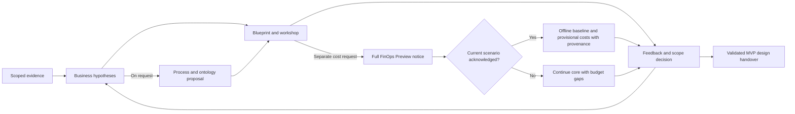

# Frontier Envisioning

| Field | Value |
|---|---|
| Version | 0.7 |
| Date | 2026-11-13 |
| Author | Urs Rüegg; Copilot AI-assisted maintenance |
| Status | Maintained internal reader guide; not release approval |
| Scope | Using and evaluating the plugin; document revision, not product version |
| References | [Documentation](docs/README.md), [Getting started](docs/getting-started.md), [Plugin guide](plugin/README.md), [Issue #31](https://github.com/urruegg/frontier-envisioning/issues/31), [Issue #33](https://github.com/urruegg/frontier-envisioning/issues/33), [Issue #35](https://github.com/urruegg/frontier-envisioning/issues/35) |

**Turn scoped business evidence into a Frontier Company Blueprint and a focused workshop.**

Frontier Envisioning is a Copilot Cowork plugin for Microsoft Innovation Hub
solution engineers. It helps frame opportunities across business journeys,
for example Sales and Services, test hypotheses with people and prepare a
validated MVP for design handover.

**1.10.0 is an UNRELEASED internal candidate**, not a published release.
This repository is private; internal sharing does not grant public visibility,
customer redistribution or IP clearance. Maintainer: [@urruegg](https://github.com/urruegg).

## See it, try it, use it

1. **See the outcome:** [Caldova gallery and offline HTML](docs/demo/README.md).
   Caldova Industrial AG is fictitious; the example is synthetic and not deployed.
2. **Try the HTML without installing:** [download and open it locally](docs/getting-started.md#try-the-example-without-installing).
   GitHub and OneDrive previews do not execute the interactive HTML.
3. **Use it in Cowork:** follow [getting started](docs/getting-started.md), then
   adapt a [starter prompt](docs/starter-prompts.md).

*Overview preview — proposed mission, Frontier phases and illustrative business
outcomes, not operational results.
The [five-view gallery](docs/demo/README.md) also shows Org model, Agents,
Agent identity and requested Ontology.*

## What you get

| Output | Purpose |
|---|---|
| Context pack and evidence log | Cited facts, inferences, hypotheses and gaps from scoped, authorised sources |
| Frontier Company Blueprint | One offline HTML file across Vision, Design, Build and Workshops; not a new custom app or published tenant service |
| Workshop preparation and feedback | Agenda, questions, scope decisions and exported feedback for the next version |
| Agent identity proposal | Names, colours, icons and identity cards; branding, not Entra identity provisioning |
| Value and design handover | Ordinary value evidence and assumptions; PRD, solution design, ADRs and IT readiness once MVP scope is validated, or clearly labelled drafts |
| Optional Agent FinOps baseline | After Preview awareness: versioned twelve-month scenarios, unit economics and projected JSON/Markdown reports; recorded external review is not budget approval |

## Install the internal candidate

Obtain the approved internal `frontier-envisioning-plugin-1.10.0.zip` from the
maintainer and keep it zipped. In a new Copilot Cowork chat, attach it and type
**Install the Frontier PlugIn**. Review the installation approval prompts.
Start a new chat after sync. See the [packaged guide](plugin/README.md) for
integrity checks, updates, removal and administrator-managed roll-out.
These instructions are not evidence of an actual Cowork installation.

## Know the boundaries

- **Eight skills:** seven non-FinOps GA product wrappers, including optional
  process/ontology when requested, plus bundled optional Preview FinOps.
  Core work does not require FinOps.
- **FinOps is off by default.** Cost operations or figures require the
  [full Preview notice and actual current-scenario acknowledgement](plugin/README.md#optional-finops-preview--awareness-first).
  Installation and previous runs are not consent. Declining continues core
  with honest budget gaps, not zero costs or a readiness waiver.
- **Financial evidence is required at build handover.** Draft workshops can
  continue with gaps. Handover needs each scoped agent's complete, priced
  baseline and review against its frozen version/hash; unpriced or synthetic
  evidence cannot pass. The [offline baseline procedure](plugin/skills/frontier-finops/SKILL.md#quick-start--requested-versioned-baseline)
  remains Preview and grants no financial or deployment permission.
- **Evidence before confidence.** GA is the maintainer's product designation,
  not provider GA, result confidence, deployment, release or external clearance.
  Fabric ontology/data-agent/operations remain Preview, proposed mappings need
  checking and MOS3 packaging remains `devPreview`.
- **Read-only inputs, reviewed outputs.** Work IQ/tool availability depends on
  the authorised harness. HubWorks requires a controlled, authorised integration;
  it is not a universal runtime loader. Review customer projections, embedded
  data and downloads before any permitted sharing.

## Engineering and records

Use the [documentation catalogue](docs/README.md) for engineering guides and
historical evidence, [workstation setup](docs/engineering/workstation-setup.md)
for dependencies, and [AGENTS.md](AGENTS.md) and
[CONTRIBUTING.md](CONTRIBUTING.md) for repository work.
[Requirements](docs/prd.md) and [solution design](docs/solution-design.md)
remain authoritative. [Gallery maintenance](docs/demo/README.md#regenerate-and-check)
explains sample regeneration and CI drift checks.

## Licence

MIT, see [LICENSE](LICENSE). Copyright (c) 2026 Urs Rüegg. Microsoft product icons are trademarks of Microsoft and are used under Microsoft's icon terms; see [plugin/THIRD-PARTY-NOTICES.md](plugin/THIRD-PARTY-NOTICES.md).
