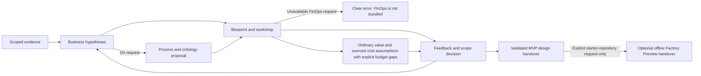

# Frontier Envisioning

| Field | Value |
|---|---|
| Version | 0.11 |
| Date | 2026-11-26 |
| Author | Urs Rüegg; Copilot AI-assisted maintenance |
| Status | Maintained internal reader guide; not release approval |
| Scope | Using and evaluating the plugin; document revision, not product version |
| References | [Documentation](docs/README.md), [Getting started](docs/getting-started.md), [Plugin guide](plugin/README.md), [Issue #31](https://github.com/urruegg/frontier-envisioning/issues/31), [Issue #33](https://github.com/urruegg/frontier-envisioning/issues/33), [Issue #35](https://github.com/urruegg/frontier-envisioning/issues/35) |

**Turn scoped business evidence into a Frontier Company Blueprint and a focused workshop.**

Frontier Envisioning is a Copilot Cowork plugin for Microsoft Innovation Hub
solution engineers. It helps frame opportunities across business journeys,
for example Sales and Services, test hypotheses with people and prepare a
validated MVP for design handover.

**1.11.0 is an unreleased development candidate.** It adds the offline
Envisioning Agent Factory producer for an explicitly requested starter-repository
handover. Eight skills are registered: seven existing GA wrappers, including
Business Value Case, plus optional Preview Factory. Nine source folders remain;
FinOps is source-only, not registered, copied or installed in this Cowork ZIP.
Final amended-candidate checks remain pending, not a Cowork-validated claim.
Historical release build **1.10.0** and its evidence are unchanged. Check
[GitHub Releases](https://github.com/urruegg/frontier-envisioning/releases)
for actual publication and downloads; candidate metadata is not publication.
This repository is private; internal sharing does not grant public visibility,
customer redistribution or IP clearance. Maintainer: [@urruegg](https://github.com/urruegg).

## See it, try it, use it

1. **See the outcome:** [Caldova gallery and offline HTML](docs/demo/README.md).
   Caldova Industrial AG is fictitious; the example is synthetic and not deployed.
2. **Try the HTML without installing:** [download and open it locally](docs/getting-started.md#try-the-example-without-installing).
   GitHub and OneDrive previews do not execute the interactive HTML.
3. **Use it in Cowork:** follow [getting started](docs/getting-started.md), then
   adapt a [starter prompt](docs/starter-prompts.md).

*Overview preview — proposed mission, Frontier phases and illustrative business
outcomes, not operational results.
The [ten-capture gallery](docs/demo/README.md) also shows Org model, Agents,
Agent identity, Target architecture, requested Ontology and workshop views.*

## What you get

| Output | Purpose |
|---|---|
| Context pack and evidence log | Cited facts, inferences, hypotheses and gaps from scoped, authorised sources |
| Frontier Company Blueprint | One offline HTML file across Vision, Design, Build and Workshops; not a new custom app or published tenant service |
| Workshop preparation and feedback | Agenda, questions, scope decisions and exported feedback for the next version |
| Agent identity proposal | Names, colours, icons and identity cards; branding, not Entra identity provisioning |
| Value and design handover | Ordinary value evidence and assumptions; PRD, solution design, ADRs and IT readiness once MVP scope is validated, or clearly labelled drafts |
| Optional Envisioning Agent Factory Preview | Registered candidate offline producer: full pinned starter-repository ZIP with reviewed ordinary files, preserved IDs and explicit intake gaps; final integration proof pending |

### Candidate skill inventory

The 1.11.0 candidate registers **eight skills in the same plugin**: seven existing
GA wrappers and optional Preview Factory. Final amended-candidate proof is tracked
in [#81](https://github.com/urruegg/frontier-envisioning/issues/81).
FinOps source and regression tests remain outside this distribution; see the
[release boundary](plugin/README.md#finops-not-included-in-1110).

| Skill | Availability and purpose |
|---|---|
| `frontier-envisioning` | GA — engagement orchestration |
| `frontier-context-discovery` | GA — scoped context and evidence |
| `frontier-blueprint` | GA — interactive blueprint and workshops |
| `frontier-solution-design` | GA — PRD, design, ADRs and readiness |
| `frontier-agent-identity` | GA — proposed branding and identity kit |
| `frontier-value-case` | GA — ordinary value evidence and assumptions |
| `frontier-process` | GA — optional process/ontology proposals |
| `frontier-agent-factory` | Registered optional Preview candidate — Envisioning Agent Factory |

## Install the plugin

For a published build, obtain its exact versioned ZIP from
[GitHub Releases](https://github.com/urruegg/frontier-envisioning/releases).
The prospective `frontier-envisioning-plugin-1.11.0.zip` is a development
candidate; use only a maintainer-provided candidate after its integration and
package checks are recorded. Those checks are currently pending. Keep the ZIP zipped.
In a new Copilot Cowork chat, attach it and type
**Install the Frontier PlugIn**. Review the installation approval prompts.
Start a new chat after sync. See the [packaged guide](plugin/README.md) for
integrity checks, updates, removal and administrator-managed roll-out.
These instructions are not evidence of an actual Cowork installation.

## Know the boundaries

- **Independent optional extensions:** ordinary core, value, identity,
  blueprint, design and process work needs neither Factory nor FinOps.
  Factory is only for an explicit starter-repository/ZIP/handover request,
  not a new default after a PRD or an automatic cost operation.
- **Factory is source handover, not a business runtime.** The offline producer
  preserves a compatible full foundation and reviewed inputs; it creates no
  SDK, application, tenant loader, remote repository or deployed resource.
  Read the [candidate procedure and input limitation](plugin/README.md#optional-agent-factory-preview--offline-candidate).
  Actual Cowork discovery, installation, acquisition and export are not performed.
- **FinOps is not included in 1.11.0.** The
  [distribution boundary](plugin/README.md#finops-not-included-in-1110)
  excludes FinOps cost modelling, Copilot Credits and FinOps-derived validation.
  Ordinary value and sourced cost assumptions remain supported with honest
  budget gaps, not zero costs or unsupported ROI.
- **Financial provenance and refusals remain.** Retained source-compatibility
  rules require complete, priced baselines and exact frozen-target owner review
  for financial build handover; unpriced or synthetic evidence cannot pass.
  The ZIP cannot perform absent owner validation, even with acknowledgement.
  Continue ordinary drafts with named gaps, never claim financial readiness or
  financial/deployment permission.
- **Evidence before confidence.** GA is the maintainer's product designation,
  not provider GA, result confidence, deployment, release or external clearance.
  Fabric ontology/data-agent/operations remain Preview, proposed mappings need
  checking and MOS3 packaging remains `devPreview`.
- **Read-only inputs, reviewed outputs.** Work IQ/tool availability depends on
  the authorised harness. HubWorks requires a controlled, authorised integration;
  it is not a universal runtime loader. Review customer projections, embedded
  data and downloads before any permitted sharing.

## Engineering and records

Use the [documentation catalogue](docs/README.md) for engineering guides and
historical evidence, [workstation setup](docs/engineering/workstation-setup.md)
for dependencies, and [AGENTS.md](AGENTS.md) and
[CONTRIBUTING.md](CONTRIBUTING.md) for repository work.
[Requirements](docs/prd.md) and [solution design](docs/solution-design.md)
remain authoritative. [Gallery maintenance](docs/demo/README.md#regenerate-and-check)
explains sample regeneration and CI drift checks.

## Licence

MIT, see [LICENSE](LICENSE). Copyright (c) 2026 Urs Rüegg. Microsoft product icons are trademarks of Microsoft and are used under Microsoft's icon terms; see [plugin/THIRD-PARTY-NOTICES.md](plugin/THIRD-PARTY-NOTICES.md).
