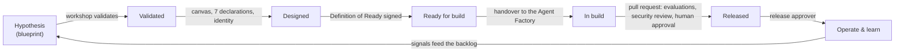

# Frontier Envisioning — visualisation and reuse evaluation

| Field | Value |
|---|---|
| Document | Evaluation: plugins for visualising the target architecture, landing zone and Agent Factory; CAT components to reuse; the agent orchestration workflow with the GitHub harness |
| Version | 1.0 — for discussion |
| Date | 8 November 2026 |
| Author | Urs Rüegg, Sr Solution Engineer, Microsoft Innovation Hub Switzerland |
| Scope | Frontier Envisioning plugin 1.4.0 (blueprint along the Innovation Hub journey) |
| Basis | The HR and procurement Frontier workshops of autumn 2026 (architecture design pack, landing zone, CAT reuse review), the CAT Agent Skills gallery, the CAT blog on the new harness resources, Microsoft Learn (checked 8 November 2026) |

---

## 1. Summary

1. **The blueprint needs no extra plugin to show the architecture.** Release 1.4.0 draws the landing zone, the Agent Factory board, the ADR cards and the IT readiness page itself, offline, with agent identity icons and Microsoft product icons.
2. **For other media, use what is installed and add one capability later.** The pptx skill makes editable slides, HubWorks' architecture-diagram-builder makes quick Mermaid sketches from transcripts, and a future `frontier-diagrams` skill would export draw.io, Mermaid and SVG from the blueprint, using the official Microsoft icon sets.
3. **Reuse the CAT agent skills by reference, step by step.** 19 CAT skills fit the seven factory steps, and four ALM accelerators fit the pipeline. We link to them and install them next to the plugin; we don't copy them.
4. **One workflow from hypothesis to operate.** Hypothesis → validated → designed → ready for build → in build → released → operate. Each stage has a gate, an owning factory agent, evidence and product icons. "Ready for build" is the Hub's Definition of Ready: eight handover checks the HTML computes for every agent.
5. **Gaps to close.**
   - The product icons are copies from presentation decks; swap in the official icon sets.
   - Some harness naming is not yet confirmed on Microsoft Learn.
   - Microsoft has no official "ready for build" definition.
   - No CAT tool draws Copilot Studio agent diagrams.

## 2. What the blueprint already visualises (1.4.0)

| Part | View | Visual | Icons |
|---|---|---|---|
| 1 Vision | Journeys > Agent Factory | Lifecycle chevrons (7 stages), agent board computed from the handover checks, handover table, build steps with tools, Superpowers and CAT skills, evaluation pyramid L0–L5, roles, phases | Identity icons of the factory agents; GitHub, GitHub Copilot, Visual Studio Code, Copilot Studio, Agent 365, Entra, Purview |
| 1 Vision | Attendees | People by organisation, contributions, links to journeys and use cases | — |
| 2 Design | Target architecture > Landing zone | Computed diagram: tenant, identity, policies, front doors; platform landing zone (control plane, security, observability, integration); one agent landing zone per journey (DEV, TEST, PROD; data classes; MVP ring), sandbox and Agent Factory; systems of record, building blocks, vendor and retired agents; WAF, CAF and Responsible AI lenses | Product icons per design area; identity icons per agent |
| 2 Design | Target architecture > Decisions | ADR cards (Hub canon and customer), filters, workshop verdict | — |
| 2 Design | Use cases | Detail page in the Hub template (problem with provenance, value, feasibility), matrix sized by value | Identity icons of the agents |
| 2 Design | IT readiness | Preparation items, checks, workstation, questions, decisions, environments, timeline with live status | Product icons per group and control-plane option |

The diagram layout was checked by rendering the Caldova landing zone to an image (four business journeys plus the factory): no overlapping or clipped titles.

## 3. Plugins and tools for visualisation

| Option | What it gives | Landing zone | Agent Factory | Target architecture | Works offline in the HTML | Recommendation |
|---|---|---|---|---|---|---|
| Blueprint renderer (1.4.0) | Interactive views in the workshop | Yes | Yes | Layers, flows, ADRs | Yes | **Use now** |
| pptx skill (Cowork) | Editable shapes in a deck | From the blueprint data | Lifecycle and steps | Layers | n/a | **Use** for customer decks and steering committees |
| HubWorks architecture-diagram-builder | Mermaid diagrams grounded in transcripts | Sketch only | Sketch only | Quick sketch | n/a | **Use** in the Hub flow; hand it the blueprint as context (HubWorks integration, Frontier 1.7) |
| Mermaid in markdown (flowchart, architecture-beta) | Diagrams in the solution design and repositories | Simplified | Workflow | Yes | Not used in the HTML | **Adopt** in the solution design without icons; icon packs would need a network fetch |
| draw.io (diagrams.net) | Editable architecture diagrams with imported official SVG icons | Yes | Yes | Yes | n/a | **Adopt** as the export format for architects (frontier-diagrams) |
| Excalidraw | Whiteboard-style sketches in workshops | Sketch | Sketch | Sketch | n/a | Optional |
| image-operations | Pictures and illustrations | No (not exact) | No | No | n/a | Hero visuals only |
| Power BI and App Builder | Live cockpit: factory board, value plan against actual, FinOps | n/a | Live stages | n/a | n/a | **Operate loop** (Frontier 1.7) |

**Proposed capability: `frontier-diagrams` (later release).** The inputs are `blueprint.normalized.json`, the agent identity kit and the official icon sets (downloaded by the user under Microsoft's terms). The outputs are:
- `landing-zone.drawio`, `target-architecture.drawio` and `agent-factory.drawio`
- Mermaid blocks in `solution-design.md` (one flow per MVP agent: trigger → workflow → agent → approval seam → system write)
- SVG and PNG of the HTML diagrams for slides

Acceptance criteria:
- the same layout and colours as the HTML
- icons unaltered, with the product name next to each
- offline, and the build is deterministic

The Well-Architected Framework guidance on architecture design diagrams sets the conventions.

## 4. CAT components to reuse

The CAT Agent Skills gallery publishes MIT-licensed SKILL.md skills for Copilot Studio, Cowork and Scout. The plugin names them per factory step and links to the gallery; it doesn't copy them. Check each skill's page and licence before use, and treat experimental items as such.

| Factory step | Owning factory agent | CAT skills | How we reuse them |
|---|---|---|---|
| 1 Idea & intake | Spec Architect | AI Use Case Assessment | Cross-check the use-case cards before the workshop |
| 2 Design | Spec Architect | Copilot Agent Advisor · Copilot Studio Harness Picker · Topic Blueprint · Enterprise Agent Design Authority (EADA) · Agent RAI Impact Assessment | Build choice and harness decision as an ADR; RAI impact assessment before "designed" |
| 3 Specify & plan | Spec Architect, Eval Engineer | Agent Evaluation Designer · Copilot Studio Knowledge Readiness · Copilot Studio MCP Readiness | Evaluation sets and readiness checks as files in the repository |
| 4 Build (DEV loop) | Copilot Studio Builder | Skill Authoring Coach · Agent Harness Explorer · Tool Tracer | Help while building skills and tracing tool calls |
| 5 Verify (pull request) | Security Reviewer | Copilot Studio Test Planner · Agent Test · Agent Red Team · Power Platform Solution Compare | Tests, red teaming and solution diff as pull-request evidence |
| 6 Release | Release Manager | Power Automate Documentation | Release notes and flow documentation |
| 7 Operate & learn | Ops Analyst | Agent Performance Triage · Cowork & Work IQ Consumption Advisor | Monthly agent review: quality, consumption, incidents |

**ALM accelerators for the pipeline**

| Accelerator | Use |
|---|---|
| copilot-alm-starter (GitHub) | Starting point for the factory repository and GitHub Actions |
| Evaluation gate in Azure DevOps (CAT blog) | Evaluation gate when the customer's control plane is Azure DevOps |
| Agent Review Pipeline (Copilot Agent Kit) | Review step before release |
| Power Platform CLI `pac copilot` | Push and pull agent files between the repository and DEV |
| Copilot Studio plugin with the mcs-assistant (experimental) | Builder support in the IDE; not for production gates |
| New Copilot Studio tech guide | Reference patterns for the build team |

## 5. Agent orchestration workflow with the GitHub harness

| Stage | Gate to the next stage | Owner | Factory agent | Tools (icons in the blueprint) | Evidence |
|---|---|---|---|---|---|
| Hypothesis | The workshop validates the use case and the agent | Product owner | Spec Architect | Microsoft 365 Copilot | Blueprint, use-case card |
| Validated | Canvas, seven declarations and identity complete | Product owner | Spec Architect | Copilot Studio | Workshop verdict merged |
| Designed | Definition of Ready signed by the product owner and the technical owner | Product and technical owner | Spec Architect | GitHub | Design document, harness ADR |
| Ready for build | Handover to the Agent Factory | Product owner | Spec Architect, Eval Engineer | GitHub, GitHub Copilot | Specification, plan and evaluation sets in the repository |
| In build | Pull request with evaluations and security review, approved by a person | Maker or developer | Builder, Eval Engineer, Security Reviewer | GitHub Copilot, Visual Studio Code, Copilot Studio | Commits with passing evaluations; pull request with checks |
| Released | Release approver approves through the customer's change process | Release approver | Release Manager | GitHub, Copilot Studio | Release notes from linked work items |
| Operate & learn | The business owner promotes autonomy | Operations and business owner | Ops Analyst | Agent 365, Microsoft Entra, Microsoft Purview | Monthly agent review |

**Definition of Ready (the handover package).** The HTML computes these eight checks for every agent and shows them on the factory board.

| Check | Source in the blueprint |
|---|---|
| Validated in the workshop | Workshop verdict (`agent:<id>`) |
| Trigger canvas complete | Agent canvas |
| Seven declarations made | Agent declarations |
| Identity: display names and icons | Agent identity kit |
| Business value validated (gate V2) | Value case on the use case |
| Cost envelope modelled (gate F1) | FinOps agent line |
| IT readiness for the build stage | IT readiness items up to the build stage done |
| Agent boss named | Agent owner |

**How the GitHub harness runs.**
- Development is specification-driven: the specification, plan and evaluation sets live in the repository.
- GitHub Copilot (agent mode or CLI) builds task by task; Superpowers skills guide each step: brainstorming, writing plans, test-driven development, worktrees, subagent-driven development, verification, code review, finishing the branch and debugging.
- `main` is protected, and code owners approve every pull request.
- GitHub Actions deploys through environments with approvals and federated credentials.

**Azure DevOps alternative.** When the customer standardises on Azure DevOps, the same loop runs with Boards, Pipelines, the Power Platform Build Tools and the evaluation gate. The control plane stays open until decision D-01 of the IT readiness page.

**Harness choice.** Microsoft Learn's "Choose a harness" page describes the options for Copilot Studio agents, and the CAT Harness Picker helps decide. Record the choice as an ADR per agent. Re-check the harness names on Learn before a customer session: one name we have seen ("Copilot Chat harness") is not yet confirmed there.

**Each agent's runtime workflow (added in plugin 1.6.0).** The lifecycle above moves an agent from hypothesis to build. Inside it, the Agents view now draws what the agent will run: a Copilot Studio workflow from the trigger through the designer's nodes (Agent, Classify, Extract, Copilot, Human review, Connector, Function, Variable, If/Else, Loop) to the desired outcome, derived from the canvas plan until the workshop refines it. The solution design carries the same workflow as the build table for the Copilot Studio builder. No additional plugin is needed for this view; an export into Copilot Studio stays with the prototype pack (PROTO-01).

## 6. Gaps and risks

| Gap | Impact | Mitigation | Decision |
|---|---|---|---|
| Product icons copied from presentation decks | Icon terms are respected, but the provenance is not the official sets | Replace them with the official Power Platform, Azure, Entra and Dynamics 365 icon sets; keep the notice and the opt-out | D-07 (plugin PRD) |
| No official Microsoft definition of "ready for build" | Customers may expect a Microsoft standard | Present the eight checks as the Innovation Hub canon; align with the Copilot Studio ALM guidance | Hub leadership |
| Harness naming partly unconfirmed | Wrong names in front of customers | Check Learn before each architecture workshop | Each SE |
| No CAT tool draws agent architecture diagrams | Diagrams outside the HTML are manual | `frontier-diagrams` (draw.io, Mermaid, SVG) | E-01 below |
| Mermaid icon packs need a network fetch | Not usable in offline documents | Plain Mermaid in documents; icons only in draw.io and the HTML | — |
| Visual checks were headless plus an image of the diagram | Small layout issues in some browsers | Open the demo in Edge before customer use | — |
| CAT skills change and some are experimental | Broken links or behaviour changes | Link, don't copy; check before use | — |

## 7. Recommendation and next steps

| ID | Proposal | When |
|---|---|---|
| E-01 | Build `frontier-diagrams` (draw.io, Mermaid, SVG from the blueprint and the identity kit) | After the operate loop (later release) |
| E-02 | Download the official icon sets, replace the copies and name a maintainer | Next release (D-07) |
| E-03 | Install the CAT skills for steps 2, 3 and 5 next to the Frontier plugin in Hub Cowork; pilot them on one engagement | Next architecture design workshop |
| E-04 | Keep GitHub and Azure DevOps both open in the canon, or recommend one (D-08) | Hub solution engineering |
| E-05 | Hand the blueprint to HubWorks' architecture-diagram-builder as context (part of the HubWorks integration) | Frontier 1.7 |

## 8. Sources

- CAT Agent Skills gallery: https://microsoft.github.io/cat-agent-skills/
- New Harness, New Rules? CAT's Got You: https://microsoft.github.io/mcscatblog/posts/new-orchestrator-resources/
- Choose a harness (Microsoft Learn): https://learn.microsoft.com/en-us/microsoft-copilot-studio/guidance/choose-harness
- ALM for Copilot Studio (Microsoft Learn): https://learn.microsoft.com/en-us/microsoft-copilot-studio/guidance/alm
- Power Platform CLI `pac copilot`: https://learn.microsoft.com/en-us/power-platform/developer/cli/reference/copilot
- copilot-alm-starter: https://github.com/microsoft/copilot-alm-starter
- Evaluation gate in Azure DevOps (CAT blog): https://microsoft.github.io/mcscatblog/posts/copilot-studio-eval-gate-azure-devops/
- Agent Review Pipeline (Copilot Agent Kit): https://learn.microsoft.com/en-us/microsoft-copilot-studio/guidance/kit-agent-review-pipeline
- Agent evaluation in Copilot Studio: https://learn.microsoft.com/en-us/microsoft-copilot-studio/agents-experience/analytics-agent-evaluation-intro
- Copilot Studio plugin (mcs-assistant, experimental): https://github.com/microsoft/copilot-studio-plugin
- New Copilot Studio tech guide: https://microsoft.github.io/new-copilot-studio-tech-guide/
- Microsoft Power Platform icons: https://learn.microsoft.com/en-us/power-platform/guidance/icons
- Azure icons: https://learn.microsoft.com/en-us/azure/architecture/icons/
- Microsoft Entra architecture icons: https://learn.microsoft.com/en-us/entra/architecture/architecture-icons
- Microsoft Dynamics 365 icons: https://learn.microsoft.com/en-us/dynamics365/get-started/icons
- Cloud Adoption Framework, AI agents: https://learn.microsoft.com/en-us/azure/cloud-adoption-framework/ai-agents/
- Azure Well-Architected Framework: https://learn.microsoft.com/en-us/azure/well-architected/
- Power Platform Well-Architected: https://learn.microsoft.com/en-us/power-platform/well-architected/
- Microsoft Responsible AI principles: https://www.microsoft.com/en-us/ai/principles-and-approach
