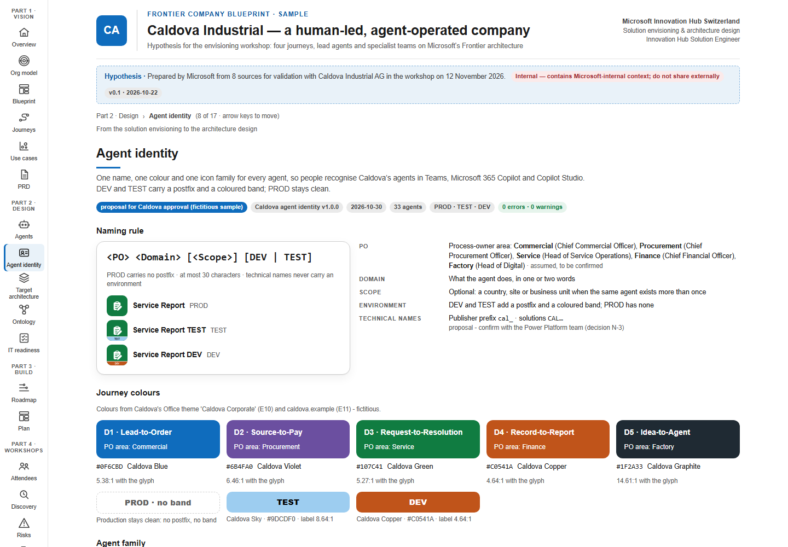
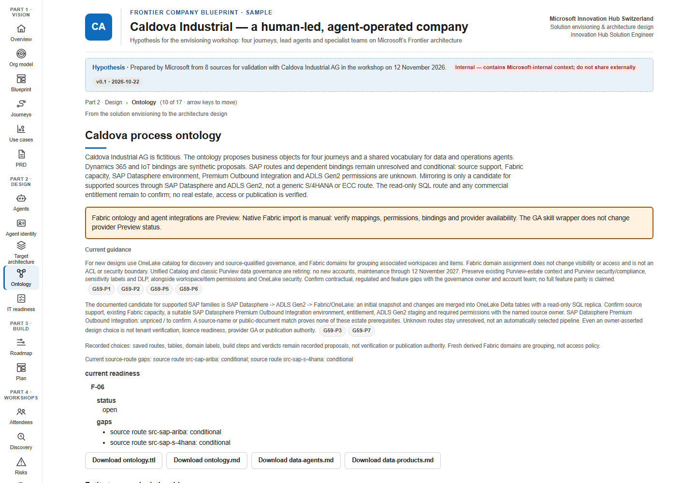

# Caldova Blueprint gallery

| Field | Value |
|---|---|
| Version | 0.2 |
| Date | 2026-11-12 |
| Author | Copilot; AI-assisted documentation |
| Status | Maintained internal example; not deployment or release evidence |
| Scope | Offline core sample, five viewport captures and regeneration; document revision, not product version |
| References | [Documentation](../README.md), [Getting started](../getting-started.md), [Starter prompts](../starter-prompts.md), [Issue #31](https://github.com/urruegg/frontier-envisioning/issues/31), [Issue #33](https://github.com/urruegg/frontier-envisioning/issues/33) |

See what the standard Frontier Company Blueprint produces before installing
the plugin. **Caldova Industrial AG is fictitious.** All business details,
people, evidence and value hypotheses are synthetic and illustrative, not
real engagement data or deployed capabilities.

## Open the interactive example

Download [caldova-blueprint.html](caldova-blueprint.html) using GitHub's raw-file
download and open the file locally in **Edge or Chrome**. GitHub and OneDrive
previews do not execute the HTML. There is no hosted URL or tenant deployment
to visit. This is one offline HTML file, not a custom application or live backend.

The **1.9.2 unreleased core** candidate retains the same example scope: identity,
ordinary value and explicitly requested Ontology, with 17 route identities and
no FinOps data.
FinOps Preview is a separate, explicitly acknowledged profile, not a hidden
cost estimate in this sample.

## Overview


The capture shows the proposed mission, Frontier phases and illustrative
business outcomes. These frame workshop discussion, not measured operational
results. Open **Overview** (`#/overview`) in the [HTML](caldova-blueprint.html)
and scroll down to explore the digital feedback loop.

## Org model


The Org model illustrates a human-led, agent-supported organisation.
Roles and responsibilities are proposals, not actual staff or provisioned identities.
Open **Org model** (`#/org`) in the [HTML](caldova-blueprint.html).

## Agents — Service Report


The capture shows the selected Service Report agent (`D3-A05`), its mission,
proposed approval mode and identity details. The agent page also contains a
canvas and illustrative workflow, including human review. Designer-style nodes
describe a proposal, not an executing Copilot Studio flow.
Open **Agents → Service Report** (`#/agents/D3-A05`) in the
[HTML](caldova-blueprint.html) and scroll down to inspect the canvas and workflow.

## Agent identity



The identity proposal makes names, colours and DEV/TEST variants consistent.
This is branding, not Entra identity provisioning or approval of brand rights.
Open **Agent identity** (`#/identity`) in the [HTML](caldova-blueprint.html).

## Ontology



The explicitly requested Ontology illustrates proposed entities, relationships
and data bindings. Unchecked mappings remain proposals. Fabric ontology,
data-agent and operations capabilities remain Preview; no tenant import or
data-agent execution is demonstrated.
Open **Ontology** (`#/ontology`) in the [HTML](caldova-blueprint.html).

## Capture provenance and limits

The five images are Playwright/Chromium **1440 × 1000 viewport captures** in
light mode, reduced motion, `en-GB` locale and UTC, with fresh browser storage.
They show selected views, not complete page coverage or an accessibility audit.

The generated [manifest](manifest.json) records the actual HTML/source and
screenshot SHA-256 values, plugin and browser/tool versions, routes and capture
settings. Use it for captured provenance, not a claim that PNG bytes are
deterministic across platforms. Screenshots do not establish actual Cowork
installation, provider availability, manual tenant acceptance or publication.

The HTML, five real captures and manifest have been regenerated for 1.9.2.
The stored and freshly rebuilt core comparison passes; broader quality and
distribution evidence is recorded separately in
[SPRINT-006](../sprints/SPRINT-006-version-1.9.2.md), not inferred from the version.

## Regenerate and check

Maintainers: use the existing [workstation setup](../engineering/workstation-setup.md)
for dependencies. From the repository root:

```bash
python tools/dev.py docs-demo
python tools/build_docs_demo.py --check --demo build/demo
```

`docs-demo` uses `tools/build_docs_demo.py` to build the core example and capture
the actual offline HTML. It generates the tracked HTML, five images and manifest;
**never hand-edit those outputs**. Review the real images after regeneration.

Strict L1 checks the stored assets, hashes and source fingerprint against a
fresh core build. For the fresh-HTML comparison, only the volatile
`meta.generated` day is normalised; other differences must be investigated.
This catches stale documentation when demo-relevant sources change. It does
not require cross-platform screenshot byte equality or prove manual acceptance.

The repository stays private. Review customer projections and confirm sharing
and IP permissions separately; an illustrative gallery is not external clearance.
