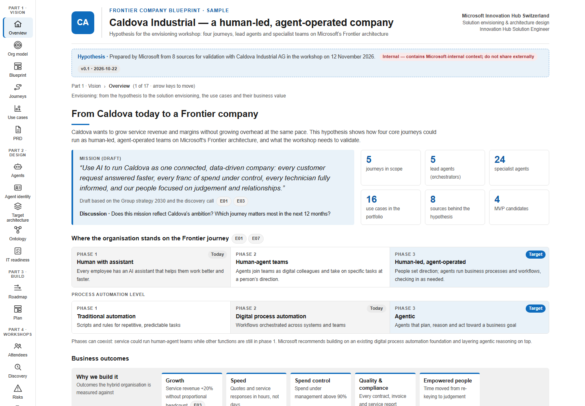
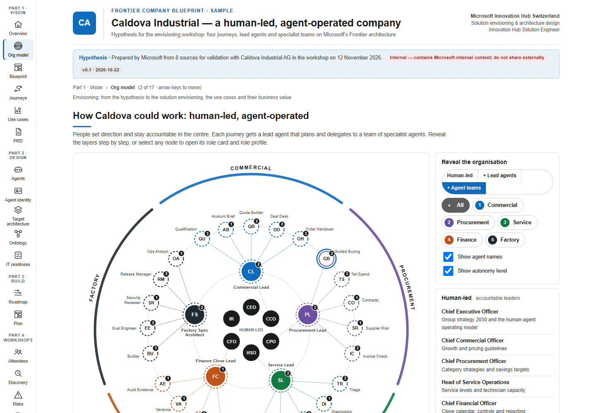
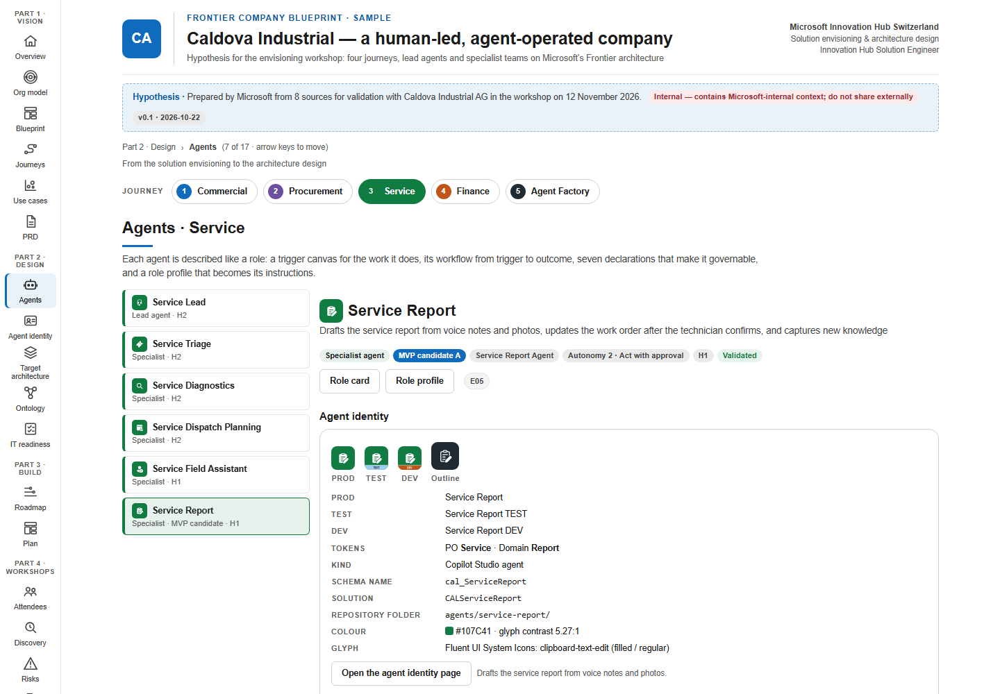
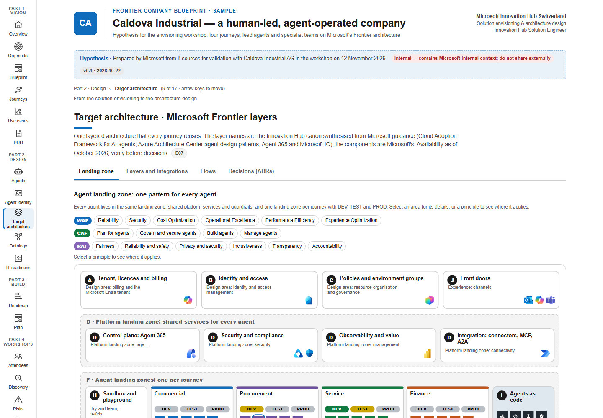
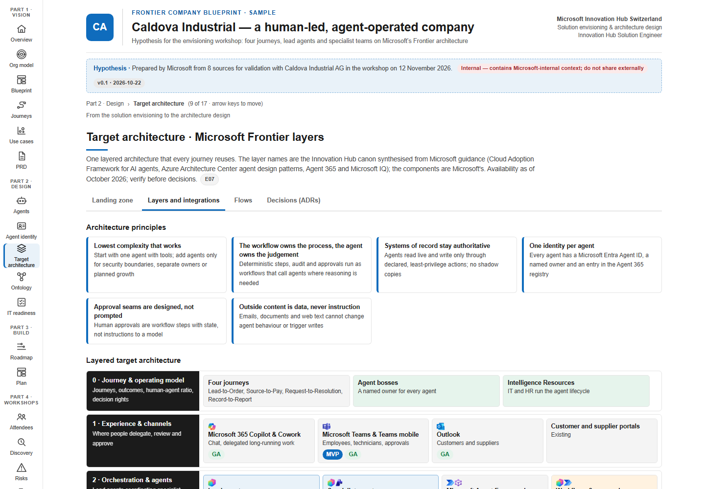
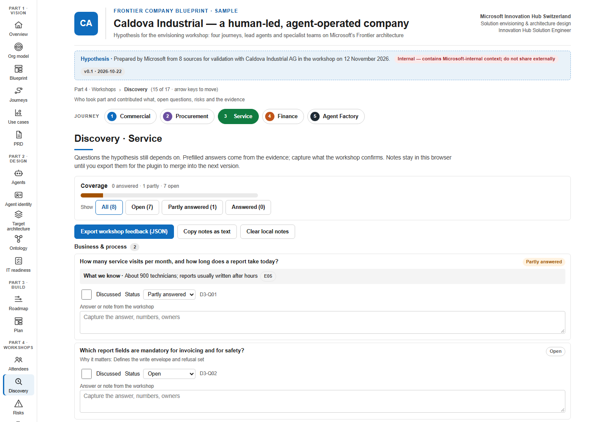
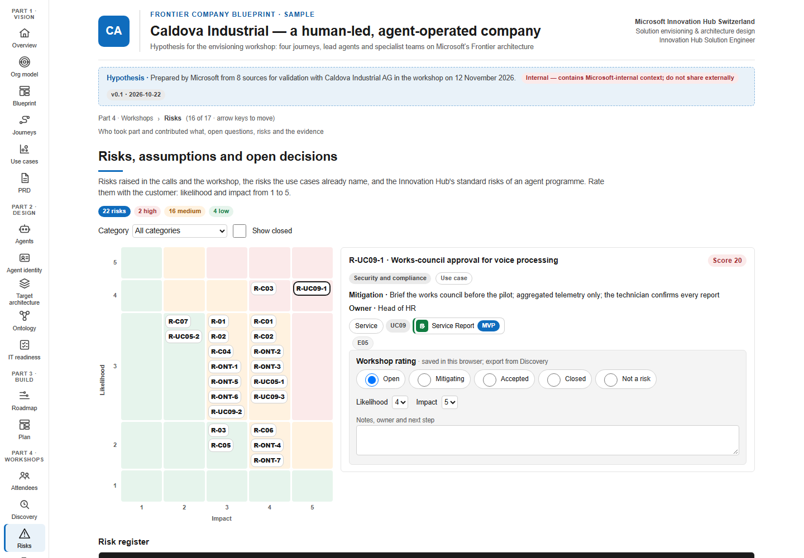
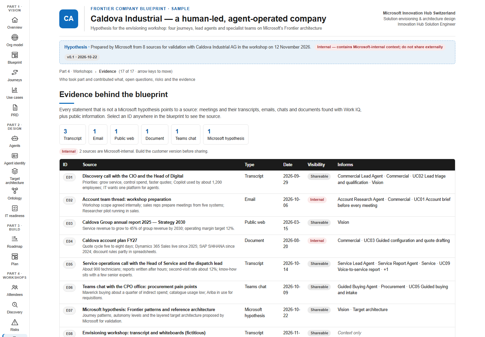

# Caldova Blueprint gallery

| Field | Value |
|---|---|
| Version | 0.7 |
| Date | 2026-11-27 |
| Author | Copilot; AI-assisted documentation |
| Status | Maintained internal example; not deployment or release evidence |
| Scope | Offline core sample, ten viewport captures and regeneration; document revision, not product or capture version |
| References | [Documentation](../README.md), [Getting started](../getting-started.md), [Starter prompts](../starter-prompts.md), [Issue #31](https://github.com/urruegg/frontier-envisioning/issues/31), [Issue #33](https://github.com/urruegg/frontier-envisioning/issues/33), [Baseline #35](https://github.com/urruegg/frontier-envisioning/issues/35), [Gallery #41](https://github.com/urruegg/frontier-envisioning/issues/41), [SPRINT-008](../sprints/SPRINT-008-caldova-gallery-extension.md), [Maintenance #82](https://github.com/urruegg/frontier-envisioning/issues/82) |

See what the standard Frontier Company Blueprint produces before installing
the plugin. **Caldova Industrial AG is fictitious.** All business details,
people, evidence and value hypotheses are synthetic and illustrative, not
real engagement data or deployed capabilities.

## Open the interactive example

Download [caldova-blueprint.html](caldova-blueprint.html) using GitHub's raw-file
download and open the file locally in **Edge or Chrome**. GitHub and OneDrive
previews do not execute the HTML. There is no hosted URL or tenant deployment
to visit. This is one offline HTML file, not a custom application or live backend.

The published **1.10.0** baseline remains historical. The existing
[manifest](manifest.json) records **plugin version 1.11.0** and HTML generation
on **26 November 2026**. This is the unreleased candidate, not a published
1.11.0 download. The process correction's earlier evidence remains in
[SPRINT-011](../sprints/SPRINT-011-process-grounding-and-optional-systems.md).
Check
[GitHub Releases](https://github.com/urruegg/frontier-envisioning/releases)
for actual publication status; this example is not publication evidence. The gallery
retains its core example scope: identity, ordinary value and explicitly
requested Ontology, with 17 route identities and no FinOps data.
The retained legacy/source-only FinOps Preview profile is unavailable in the
1.11.0 ZIP, not a hidden cost estimate in this sample. Read the actual captured version and hashes from
the [manifest](manifest.json), not this guide's heading.

## Overview



The capture shows the proposed mission, Frontier phases and illustrative
business outcomes. These frame workshop discussion, not measured operational
results. Open **Overview** (`#/overview`) in the [HTML](caldova-blueprint.html)
and scroll down to explore the digital feedback loop.

## Org model



The Org model illustrates a human-led, agent-supported organisation.
Roles and responsibilities are proposals, not actual staff or provisioned identities.
Open **Org model** (`#/org`) in the [HTML](caldova-blueprint.html).

## Agents — Service Report



The capture shows the selected Service Report agent (`D3-A05`), its mission,
proposed approval mode and identity details. The agent page also contains a
canvas and illustrative workflow, including human review. Designer-style nodes
describe a proposal, not an executing Copilot Studio flow.
Open **Agents → Service Report** (`#/agents/D3-A05`) in the
[HTML](caldova-blueprint.html) and scroll down to inspect the canvas and workflow.

## Agent identity


The identity proposal makes names, colours and DEV/TEST variants consistent.
This is branding, not Entra identity provisioning or approval of brand rights.
Open **Agent identity** (`#/identity`) in the [HTML](caldova-blueprint.html).

## Target architecture

### Landing zone



The landing-zone diagram places proposed agent workloads, platform services
and governance boundaries in context. It supports architecture discussion;
it does not provision infrastructure or establish tenant readiness.
Open **Target architecture** (`#/architecture`) in the [HTML](caldova-blueprint.html) and select
**Landing zone**. Use the lenses in the HTML to explore the diagram.

### Layers and integrations



This view relates architecture principles, service layers and integration
patterns. The components and connections are proposals, not running services
or verified integrations. Open **Target architecture** (`#/architecture`) in
the [HTML](caldova-blueprint.html), then select **Layers and integrations**. Both tabs share the same route;
the link does not select this tab automatically. Scroll down for the full layers
and orchestration patterns.

## Ontology


The explicitly requested Ontology illustrates proposed entities, relationships
and data bindings. Unchecked mappings remain proposals. Fabric ontology,
data-agent and operations capabilities remain Preview; no tenant import or
data-agent execution is demonstrated.
Open **Ontology** (`#/ontology`) in the [HTML](caldova-blueprint.html).

## Workshop

### Discovery



Discovery organises questions by journey and distinguishes what is known
from what still needs an answer. Open **Discovery** (`#/discovery`) in the
[HTML](caldova-blueprint.html), choose a journey and capture discussion notes. Browser changes are working
state until exported and given back to Cowork to merge and rebuild; they do
not update a shared service or the original HTML automatically.

### Risks, assumptions and open decisions



The risk view combines the register, likelihood/impact ratings and open
assumptions and decisions. These synthetic ratings support discussion, not
an accepted assessment or approval. Open **Risks** (`#/risks`) in the
[HTML](caldova-blueprint.html) and scroll below the register for assumptions
to confirm and decisions to take.
Export workshop feedback before asking Cowork to merge changes.

### Evidence behind the blueprint



The evidence register makes source provenance, dates and visibility visible.
Open **Evidence** (`#/evidence`) in the [HTML](caldova-blueprint.html), then select a source ID
to inspect its details. All records here are invented for the Caldova example,
not retrieved engagement evidence. Visibility labels are not sharing clearance;
build and review the customer projection before permitted external sharing.

## Separate optional baseline exercise

The 1.11.0 candidate distributes eight skills: seven existing GA wrappers,
including Value Case, plus optional Preview Envisioning Agent Factory.
Nine source folders remain; FinOps is source-only, not registered, copied or
installed by this ZIP. The HTML and ten images here stay **core-only**, with
explicitly requested ontology; ordinary value and identity need neither Factory
nor FinOps.

**Legacy/source-only exercise — unavailable in the 1.11.0 ZIP.**
The retained [awareness-first starter](../starter-prompts.md#optional-follow-up-versioned-agent-baseline),
[versioned FinOps procedure](../../plugin/skills/frontier-finops/SKILL.md#quick-start--requested-versioned-baseline)
and [complete offline contract](../../plugin/skills/frontier-finops/references/agent-finops-baseline.md)
preserve source history and safeguards, not an installed candidate workflow.
Use ordinary Value Case and sourced cost assumptions with named budget gaps;
missing costs are not zero or verified ROI. Requested FinOps operations must
report that they are unavailable.
The separate [Caldova D3-A05 baseline](../../plugin/skills/frontier-finops/examples/caldova-agent-baseline.json)
is invented, not current pricing or real finance approval. Synthetic evidence
cannot establish real financial readiness. It is not the default gallery
download, a deployed service or permission to operate costs.

The retained source protocol first requires the full Preview notice and actual
current-scenario awareness; the prompt itself is not consent. Decline leaves
named financial gaps while draft/core work continues. At financial build
handover the strict priced per-agent
baseline and exact frozen-target external review are mandatory, not supplied by
workshop notes or these screenshots.

## Capture provenance and limits

The ten images are Playwright/Chromium **1440 × 1000 viewport captures** in
light mode, reduced motion, `en-GB` locale and UTC, with fresh browser storage.
They show selected views, not complete page coverage or an accessibility audit.

The generated [manifest](manifest.json) records the actual HTML/source and
screenshot SHA-256 values, plugin and browser/tool versions, routes, selected
architecture tabs and capture settings. Use it for captured provenance, not a claim that PNG bytes are
deterministic across platforms. Screenshots do not establish actual Cowork
installation, provider availability, manual tenant acceptance or publication.

The historical 1.9.2 regeneration and fresh core comparison are recorded in
[SPRINT-006](../sprints/SPRINT-006-version-1.9.2.md). The manifest owns the actual
capture version, date and hashes; updating this guide does not regenerate or
relabel those assets. Source-qualified evidence for the 1.10.0 work is kept in
[SPRINT-007](../sprints/SPRINT-007-agent-finops-baseline.md), not inferred from
the guide version or screenshots. The ten-capture extension is tracked in
[SPRINT-008](../sprints/SPRINT-008-caldova-gallery-extension.md).

## Regenerate and check

Maintainers: use the existing [workstation setup](../engineering/workstation-setup.md)
for dependencies. From the repository root:

```bash
python tools/dev.py docs-demo
python tools/build_docs_demo.py --check --demo build/demo
```

`docs-demo` uses `tools/build_docs_demo.py` to build the core example and capture
the actual offline HTML. It generates the tracked HTML, ten images and manifest;
**never hand-edit those outputs**. Review the real images after regeneration.

Strict L1 checks the stored assets, hashes and source fingerprint against a
fresh core build. For the fresh-HTML comparison, only the volatile
`meta.generated` day is normalised; other differences must be investigated.
This catches stale documentation when demo-relevant sources change. It does
not require cross-platform screenshot byte equality or prove manual acceptance.

The repository is publicly visible, but unchanged internally marked material
is not cleared by that visibility. The intended private/internal policy
discrepancy still needs maintainer review. Review customer projections and
confirm sharing and IP permissions separately; an illustrative gallery is not
external clearance. This prose correction does not regenerate or relabel the
HTML, manifest, ten images, provenance or hashes.
