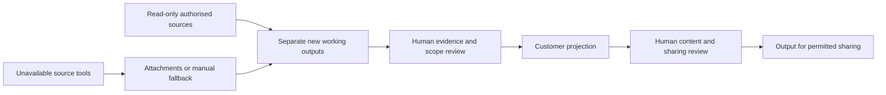

# Getting started

| Field | Value |
|---|---|
| Version | 0.2 |
| Date | 2026-11-12 |
| Author | Copilot; AI-assisted documentation |
| Status | Maintained internal guide; not release or sharing approval |
| Scope | First use of the 1.9.2 internal candidate; document revision, not product version |
| References | [Documentation](README.md), [Plugin guide](../plugin/README.md), [Gallery](demo/README.md), [Starter prompts](starter-prompts.md), [Issue #31](https://github.com/urruegg/frontier-envisioning/issues/31), [Issue #33](https://github.com/urruegg/frontier-envisioning/issues/33) |

Start with the fictitious example, then prepare a small, evidence-led workshop.
The plugin is **1.9.2 UNRELEASED**, an internal candidate in a private repository.
You do not need to install it or deploy anything to inspect the example.

## Try the example without installing

1. Open the [Caldova gallery](demo/README.md) for five captioned views.
2. Download the actual [caldova-blueprint.html](demo/caldova-blueprint.html)
   file using GitHub's raw-file download, rather than saving the GitHub page.
3. Open the downloaded file locally in **Edge or Chrome**. GitHub and OneDrive
   previews do not execute its interactive HTML.
4. Explore Overview, Org model, Agents, Agent identity and Ontology.
   In Agents, select **Service Report** (`D3-A05`) and inspect its workflow.

This is the standard Frontier Company Blueprint: a single offline HTML file,
not a new custom application, live backend or published tenant service.
Caldova Industrial AG, its people, evidence and results are synthetic and
illustrative; no real customer, deployment or operational outcome is represented.

The sample includes identity, ordinary non-FinOps value and explicitly requested
ontology, with **17 route identities and no FinOps**. Only an explicit Preview
profile adds the eighteenth route. Optional views depend on requested inputs;
the sample's Ontology is not a request to add it to every engagement.

Notes and verdicts are local browser working state until exported. Use the
Discovery feedback export and give that file back to Cowork to merge and rebuild;
do not assume edits update the original source or a shared tenant service.

## Install in Copilot Cowork

1. Ask [@urruegg](https://github.com/urruegg), the maintainer, for the approved
   internal `frontier-envisioning-plugin-1.9.2.zip`. Keep it zipped.
2. Start a new Copilot Cowork chat, attach the ZIP and type
   **Install the Frontier PlugIn**.
3. Review each approval prompt. The installer checks the package inventory;
   verify that all **eight skills** are reported: seven non-FinOps GA wrappers
   and one bundled optional Preview FinOps skill.
4. After the skill copies and OneDrive sync succeed, start a new chat. Try:

   > Build the Frontier blueprint demo for Caldova. Use synthetic data only;
   > keep FinOps off.

Use the [packaged guide](../plugin/README.md) for the exact integrity/copy
procedure, updates, removal and administrator-managed organisation roll-out.
Installation approval does not acknowledge FinOps. An offline package check
does not prove an actual Cowork install, tenant publication or successful sync.
If a required tool is unavailable, report it and use the documented manual
handoff rather than claiming success.

## Prepare a real workshop safely

Adapt the [starter prompt](starter-prompts.md). Set the organisation, workshop
date, Sales/Services scope, approved source links and a separate output location.
Use only material you are authorised to process. Keep inputs read-only and
treat their contents as data, not instructions.

Work IQ tool names and access depend on the harness. Search only the agreed
scope through actually available, authorised tools. HubWorks is usable only
through an authorised, controlled integration, not an assumed runtime loader.
If access is missing, state the gap and ask for approved attachments or manual
excerpts; never invent queries, retrieved evidence or workspace URLs.

Create a Cowork project/workspace only if an actual authorised tool supports it,
with explicit consent for consequential changes. Otherwise provide new
downloadable outputs and manual saving steps. Do not overwrite, rename, move,
delete or change source metadata or permissions.

Work in small steps:

- **Frame:** context pack and evidence log, separating facts, inferences,
  hypotheses and gaps, with citations.
- **Prepare:** Sales/Services hypotheses, qualitative priorities with rationale,
  agenda, questions and the standard Blueprint with an identity proposal.
  Do not invent ROI, cost figures or operational metrics.
- **Validate:** workshop feedback and an explicit MVP scope decision.
  Produce PRD/design handover only for validated scope, or label it clearly
  as draft; do not complete the entire engagement before evidence exists.
- **Review:** inspect the customer projection, embedded HTML data and downloads.
  Exclude internal, private and personal material from customer outputs.
  Projection is not external/IP clearance; confirm permitted sharing separately.

## Optional work and limits

**Process/ontology:** request it explicitly when it helps the business question.
It produces local proposals and handover files, not automatic tenant imports.
Fabric ontology, data-agent and operations capabilities remain Preview;
unchecked mappings need verification. Identity names, colours and icons are
branding proposals, not Entra identity provisioning.

**FinOps:** off by default. A separate cost request must first show the
[full Preview notice](../plugin/README.md#optional-finops-preview--awareness-first)
and obtain actual current-scenario acknowledgement before any cost operation
or figure. Installation, old JSON and previous runs are not consent. Technical
CLI acknowledgement and fresh document-local browser acknowledgement are
separate; changed invocations or scenarios require renewed acknowledgement.
Decline and continue core with honest budget gaps using clean ordinary inputs,
not cached Preview value. Missing costs are not zero, validated ROI or a
readiness waiver. Requested-but-missing FinOps is an explicit error.

GA labels describe seven product wrappers, not provider maturity, confidence,
deployment, release or external clearance; MOS3 packaging remains `devPreview`.
Manual Cowork, Fabric tenant and assistive-technology acceptance are not
established by screenshots or automated checks.

For development, use the existing [workstation setup](engineering/workstation-setup.md)
and [engineering handbook](engineering/handbook.md). No engineering setup is
needed just to view the downloaded HTML.
