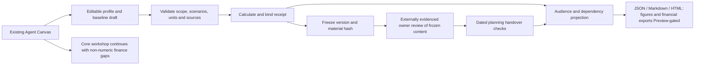

# Frontier Envisioning — Solution Design

| Field | Value |
|---|---|
| Version | 1.8 |
| Date | 2026-11-24 |
| Author | Urs Rüegg (original product document); Copilot (AI-assisted split, accessibility maintenance, selective intake, 1.9.1 prose and 1.9.2 candidate notes); AI assistant (1.10.0 candidate prose preparation); Copilot SDK (verification evidence); Copilot (AI-assisted #61 process correction prose) |
| Status | Maintained design; bounded 1.10.1 slices reviewed, final integrated/human acceptance pending; published 1.10.0 baseline retained |
| Scope | Bounded unreleased 1.10.1 process flow/verification and preserved 1.10.0/earlier design, evidence and inventory |
| References | [Product requirements](prd.md), [Product context](prd.md#product-context-and-provenance), [Docs](README.md), [D2 plan](plans/2026-11-09-documentation-foundation-plan.md), [Layout amendment](specs/2026-11-10-documentation-layout-design.md), [1.7 intake plan](plans/2026-11-10-handover-1.7-intake-plan.md), [SPRINT-004](sprints/SPRINT-004-handover-1.9-preview-finops.md), [Issue #33](https://github.com/urruegg/frontier-envisioning/issues/33), [SPRINT-006](sprints/SPRINT-006-version-1.9.2.md), [Baseline spec](specs/2026-11-12-agent-finops-baseline-design.md), [SPRINT-007](sprints/SPRINT-007-agent-finops-baseline.md), [Correction spec](specs/2026-11-17-process-governance-sap-grounding-design.md), [Correction plan](plans/2026-11-17-process-governance-sap-grounding-plan.md), [SPRINT-011](sprints/SPRINT-011-process-grounding-and-optional-systems.md), [Prose #61](https://github.com/urruegg/frontier-envisioning/issues/61) |

**Unreleased 1.6.1 distribution hygiene (#20).** Both builders reuse the package
module's bounded, recursive byte/ZIP validator before writing inventory,
archive or checksum output. Member names, text and ZIP comments are inspected;
the complete bundle no longer includes the analysis-directory wildcard.
Valid entry bytes, ordering and fixed ZIP metadata are preserved. See the
[distribution spec](specs/2026-11-10-anonymised-distribution-design.md).

This document revision is independent of the plugin version. It is the
authoritative technical design; [prd.md](prd.md) owns the requirements,
release plan, product decisions and shared product/basis/licence/provenance
and owner context.

The split preserves historical results and claims, including the original
release verification tables and dated availability. They are not new test
results or approvals. The appendix retains the original 1.6.0 inventory
(including its former combined-document path); it is not a current file list.
The [unreleased 1.6.1 requirement](prd.md#161-patch-workflow-legend-accessibility)
remains separate from these historical claims.

## 1.10.1 process grounding correction

**24 November 2026: bounded implementation for an unreleased patch.**
The [current PRD requirements/acceptance](prd.md#patch-requirements-and-acceptance),
[approved spec](specs/2026-11-17-process-governance-sap-grounding-design.md),
[exact plan](plans/2026-11-17-process-governance-sap-grounding-plan.md) and
[SPRINT-011](sprints/SPRINT-011-process-grounding-and-optional-systems.md) govern
[#59](https://github.com/urruegg/frontier-envisioning/issues/59) and this
[#61 prose slice](https://github.com/urruegg/frontier-envisioning/issues/61).
`@urruegg` is accountable. The written-spec and plan/readiness receipts record
actual human decisions; the [plan approval at 35ad763](https://github.com/urruegg/frontier-envisioning/issues/59#issuecomment-6951849396)
does not grant release, protected-record or tenant authority.
Published 1.10.0 and every historical checkpoint/count below are retained,
not revalidated by these notes.

### Current process flow and evidence boundaries

The reviewed implementation corrects the existing offline stdlib pipeline,
not a new route framework. Schema versions remain `frontier-blueprint/1.0`,
`frontier-ontology/1.0` and `frontier-fabric-iq-canon/1.0`.
The [schema reference](../plugin/skills/frontier-blueprint/references/blueprint-schema.md#additive-process-grounding-unreleased-1101)
and [method](../plugin/skills/frontier-process/references/ontology-method.md)
document the actual fields and CLI boundaries.

1. **Seed:** SAP names are intercepted before generic rules. Fresh sources
   have `path: "unresolved"`, `item: null`, `status: "later"` and an unknown
   five-record `route_assessment`; the candidate is `"mirroring"` or `null`,
   not a route selection or ready pipeline fallback.
2. **Preflight and project:** validate raw assessment shapes and reserved
   citation identities before coercion, audience projection or output effects.
   Preserve `internal`/visibility/`src`/`content_src` ancestry, including nested
   prerequisite notes, domain proposals and feedback. Public guidance cannot
   launder restricted evidence into JSON, HTML, Markdown or Turtle.
3. **Normalise a detached proposal:** preserve saved route/item/scheduling
   status, table/domain choices, IDs, citations and feedback/verdicts as
   **recorded evidence**. Missing legacy SAP assessments receive the unknown
   checklist. Derive `route_assessment.state`; do not trust imported flags.
   Append current citations without rewriting originals or retargeting S IDs.
4. **Assess design selection:** require a named source owner, an explicitly
   selected supported path/matching item and all five confirmed prerequisites
   with non-empty notes and resolvable owner-authored estate references in
   Blueprint `evidence`. Estate typing/IDs are local structural checks, not
   authentication. Public documentation, names and placeholder owners are not
   confirmation. `owner_confirmed` is an offline owner assertion, not tenant,
   licence, provider-GA, deployment or publication verification. Complete
   prerequisites do not auto-select an unresolved path.
5. **Bindings and products:** new unresolved default bindings have silver
   layer, null item/table and `origin: "default"`. Retain authored tables as
   recorded proposals, but exclude conditional sources from current bound/
   mounted claims and `stats.bound`. Add `source route <id>: conditional` gaps
   to dependent products even when their other publication fields are filled.
   Independent supported eventhouse/secondary bindings remain intact.
6. **Apply, render and export:** add `current_guidance.governance`/`.sap`,
   each `{text, src}`, alongside saved blocks. Derive
   `current_readiness["F-06"]` with `status`/`gaps`; any conditional route keeps
   it open without changing the saved F-06 verdict or note. The Blueprint
   honours that effective process F-06 status in readiness aggregates. HTML
   and all three Markdown variants/downloads carry the same current guidance.
   Existing grouping/privacy/feedback/Turtle contracts remain unchanged.

Ordinary conditional drafts succeed with named warnings. For
`build_ontology.py --strict`, warnings fail with `files: {}` before creating a
new output directory or replacing good outputs. Malformed assessments and
reserved G59 citation collisions fail even without strict mode, before
projection/output effects. Invalid references remain diagnostic; no unknown
prerequisite becomes a success default. Local deterministic files do not
certify native Fabric import or ready tenant items.

### Current sources and historical governance direction

The parent checked the [six official source records](specs/2026-11-17-process-governance-sap-grounding-design.md#evidence-known-facts-and-assessment)
on **17 November 2026**, not 24 November. Canon `checked: 2026-11-11` and
S1–S44 remain historical; G59-P1/P2/P3/P5/P6/P7 have their own updated/checked
dates and are appended to detached `sources_doc`.

New guidance uses **OneLake catalog and Fabric-domain grouping**
(G59-P1/P2/P5/P6). Assignment does not change item visibility/access, grant
permission or enforce security. Preserve actual workspace/item permissions,
OneLake security, Purview security/compliance, sensitivity labels and DLP.
Unified Catalog/classic data-governance retirement is not retirement of all
Purview. Existing-estate feature/contractual/regulatory gaps need the governance
owner/account team; no full feature parity or migration approval is asserted.
Derived `fabric_domain`/`governance_domain` keys remain for compatibility;
new labels describe grouping, while authored saved domain rows remain recorded.

[ADR-0027](adr/0027-cdm-grounding-and-data-products.md)'s earlier Purview-domain
direction and S38/S39 context are historical rationale, **qualified for current
designs by this section and the approved #59 spec**, not new creation guidance.
The ADR is not edited or accepted. It and
[ADR-0026](adr/0026-process-ontology-fabric-iq.md) remain **Proposed**; no new ADR
is needed for this sourced-guidance correction.

The SAP candidate (G59-P3/P7) is **SAP Datasphere → ADLS Gen2 → Fabric/OneLake**:
initial snapshot and changes into OneLake Delta tables with a read-only
replicated SQL surface. The five prerequisites are `supported_source`,
`fabric_capacity`, `datasphere_environment`, `premium_outbound_integration`
and `adls_gen2_permissions`. Confirm actual source-family support, existing
capacity, suitable environment, entitlement and staging permissions with the
owner. Premium Outbound Integration stays **unpriced / to confirm**; naming
that dependency is not pricing, licence approval or a FinOps operation.

Eight skills remain seven non-FinOps GA wrappers plus optional Preview FinOps;
core/process/ordinary value works without it. Separately requested financial
work keeps its awareness and strict fully priced handover requirements.
Future systems/Dynamics 365 1.11 is a separate design, not a ninth skill or
current integration capability. Unrelated manual release-workflow cleanup
[#9](https://github.com/urruegg/frontier-envisioning/issues/9) is not part of
this correction.

### Process correction verification (24 November 2026)

The following is returned parent/builder/reviewer evidence, not commands run
by this prose editor and not final whole-product acceptance.

| Checkpoint | Actual returned evidence and limits |
|---|---|
| Runtime #60, `0e1c389` | Specification and bounded correctness review PASS; source-qualified focused RED/GREEN and preservation/privacy evidence remain in SPRINT-011. |
| Renderer #62, `ccd72ce` | Specification and correctness review PASS. Current/recorded guidance, binding/readiness and real download semantics reviewed; not final L2. |
| Support #63, `da363ce` | Specification and correctness review PASS. Builder: 37 raster tests, 118 ontology/distribution tests and 77 self-test checks passed. Independent review: 37 raster tests, 14 example/CDM tests, two extracted tests and self-test passed. Counts describe separate runs, not an additive whole-product total. |
| Parent standard Playwright G59 selector | `node node_modules\@playwright\test\cli.js test ontology-preview.spec.mjs --grep G59`: one case passed under real CSP with the normal full demo and Chromium revision 1248. This is focused browser proof, not full strict L2. |
| Published 1.10.0 baseline | Downloaded manifest/ZIP hashes matched; existing independent tag-build outputs reproduced 4/4 artefacts against that manifest. Not a new build, a corrected-source reproduction of 1.10.0, or completion of #52 retention/merge. |
| Post-prose candidate | Final strict L1/L2, `docs --strict`, docs-demo regeneration, final package identity and extracted execution remain pending in the parent/CI loop. No final candidate digest or release acceptance is claimed. |

The finite named 1.10.1 raster profile preserves the measured **205 non-raster
inputs** and **223 PNG hashes**; historical profiles/assets/pins are unchanged.
The normal full-demo identity ZIP remains SHA-256
`e40b132d2e1d396ad7ee681d09931b3e35cd5728081cb01235b17396059cfdf9`.
This is the identity ZIP, **not** a final integrated plugin-package hash.

The parent owns stable final `python tools/dev.py check --strict`,
`python tools/dev.py site e2e --strict`, `python tools/dev.py docs --strict`,
generated gallery/captures and exact post-prose package/extraction/repeat-build
proof. No full gate/site/demo/capture is run by this writer.
Human-only [#52](https://github.com/urruegg/frontier-envisioning/issues/52)
manifest retention/merge and
[#8](https://github.com/urruegg/frontier-envisioning/issues/8) protected routing/
native controls remain pending. Cowork/manual tenant, source/entitlement/
permissions, licence, native-import, financial review, sharing and release
sign-off are separate. Bounded reviews do not waive them.

## 1.10.0 development candidate

This section records the development/verification context of **1.10.0**.
The [current release preparation](prd.md#1100-release-preparation) records the
normal-release metadata choice and separate human publication boundary.
The architecture was
approved on 12 November; local runtime gates were verified on 13 November 2026.
The [PRD candidate section](prd.md#1100-development-candidate) owns requirements,
release position and D35-01–D35-11. The
[idea](ideas/2026-11-12-agent-finops-baseline.md),
[approved spec](specs/2026-11-12-agent-finops-baseline-design.md),
[plan](plans/2026-11-12-agent-finops-baseline-plan.md) and
[SPRINT-007](sprints/SPRINT-007-agent-finops-baseline.md) govern
[#35](https://github.com/urruegg/frontier-envisioning/issues/35)/
[#36](https://github.com/urruegg/frontier-envisioning/issues/36).
[ADR-0028](adr/0028-versioned-agent-finops-baselines.md) remains **Proposed**,
not permission or accepted financial authority.

The engine, records/projection/CLI, build integration and renderer now have
reviewed implementation checkpoints in SPRINT-007. The local strict runtime
results below bind program source `5262db5`; exact archive/CI and remaining
human checks are recorded separately. They do not prove real prices,
authenticated owner authority or a published/deployed product.
All material from the 1.9.2 heading onwards, including historical B.9 results,
retains its original chronological meaning.

### Offline file boundaries

Only the brief's section 23 baseline-first slice belongs here. Retain eight
skills, seven non-FinOps GA wrappers and optional Preview `frontier-finops`.
Core/ordinary value, workshops and drafts must continue without importing or
calling FinOps, including on decline. Financial completeness gates build
handover only; non-numeric gaps are safe core output, not an automatic pass.

Use the existing Python 3.11+ standard-library, offline deterministic file
architecture. The files below are relative to
`plugin/skills/frontier-finops/`; this is not a new server/application layout.

| File/boundary | Candidate responsibility |
|---|---|
| `scripts/baseline_model.py` | Contract/reference validation, explicit gaps, Decimal parsing, source freshness and material-input fingerprint. |
| `scripts/baseline_calc.py` | Guarded deterministic arithmetic, typed rate/FX resolution, evidenced driver coverage, calculation receipts and integrity checks. |
| `scripts/baseline_records.py` | Draft seed/explicit migration, exclusive frozen versions, external review records and dated financial-handover evaluation. |
| `scripts/baseline_projection.py` | Audience/dependency projection and report shaping before Markdown/JSON/Blueprint serialisation. |
| `scripts/agent_finops.py` | Thin CLI over those modules; diagnostics and acknowledgement preflight before financial writes. |
| Existing `scripts/finops_preview.py` | Reuse `NOTICE`, `require_preview_ack`, `fingerprint`, `is_private` and `inherit_restrictions`; no alternative consent or privacy mechanism. |
| `examples/caldova-agent-baseline.json`, `references/baseline-sources.json` | Separate synthetic example and four dated concept-reference records, not commercial rates or copied articles. |
| Existing wrapper and renderer | Optional `agent_finops` projection, existing Canvas/Factory/Plan/FinOps views and gated exports; no independent browser financial engine. |

No ninth skill, new dependency, database, credential store or live service is
part of this boundary. D1 [#38](https://github.com/urruegg/frontier-envisioning/issues/38)
owns the engine; D2 [#37](https://github.com/urruegg/frontier-envisioning/issues/37)
owns integration; D3 [#39](https://github.com/urruegg/frontier-envisioning/issues/39)
owns preparation and final proof. The sole accountable human owner is `@urruegg`.

Actual integration decision D35-11 keeps combined ontology/baseline builds in
scope. Root Blueprint evidence and ontology-local source registers are not
silently treated as one namespace. A shared resolver works on a detached view,
retains actual consumed ancestry/classes/scopes and rejects ambiguous or
colliding identities during preflight before any output. Original inputs and
ontology references remain intact; unrelated agents/sources do not taint an
independent financial record.

### Offline flow and external trust boundary



The profile links an existing agent ID to business, technical and finance
owners, outcome, demand, assumptions/exclusions/risks/confidence, measurement
and guardrails. Working drafts remain editable. A frozen version/hash binds
material profile, scope, quantities, scenarios, rates, FX, sources and privacy
ancestry. Receipts bind that material payload, dated evaluation context and
results; stale/mismatched receipts must reject before reuse.

Owner review is a separate externally evidenced decision naming actor, date,
evidence reference and the frozen version/hash. A lifecycle `approved` string,
workshop note, imported status or Preview acknowledgement cannot supply that
review. Material changes create a new revision without inherited review;
preserve earlier snapshots. Stale evidence blocks a new handover without
rewriting historical decisions.

**Offline review records are not authenticated financial authority,
tamper-proof storage, access control, budget/purchase approval or deployment
permission.** Hash binding detects content mismatch; it does not authenticate
the reviewer or secure storage. Valid structure, complete current pricing,
owner review and dated planning readiness are separate checks. Every in-scope
cost driver must have applicable current evidenced rates/required FX and valid
quantities, with model, review, measurement, guardrails and sharing satisfied.
No conditional unpriced exception exists.

### Calculation, evidence and legacy separation

The successor contract is `frontier-finops-baseline/1.0`, beside unchanged
`frontier-finops/1.0`. Reject unsupported schemas, duplicate/unresolved IDs and
ambiguous active legacy/successor cost sources. Explicit migration preserves
originals and source restrictions, yields a draft and inherits no approval.
Neither old CHF/FX semantics nor legacy value/NPV calculations are silently
reinterpreted. A separate `agent_finops` Blueprint projection must not merge
its totals into legacy `finops` or automatically copy them into the value case.

Use decimal strings or explicit `null` gaps, finite non-negative quantities
and rates, typed quantity/pricing units and blocks; booleans are not numbers.
Pricing-block and FX divisors are positive. Exactly low/expected/high each
have twelve monthly demand values. Demand and another referenced, sourced
cost/outcome uncertainty must actually vary and affect calculation dependencies,
not merely match a permitted name or multiply a final total.

Calculate monthly/annual recurring, one-time and first-year estimates from
the declared demand profile. Preserve supplied rate precision; final monetary
aggregation uses cents with `ROUND_HALF_UP` and
unit metrics to six decimal places. Per-run, successful-run and defined-outcome
metrics identify the same period and recurring/first-year basis as their costs.
Zero/missing denominators are unavailable with reasons, never zero/infinity.
Forecasts remain estimates; measured/allocated inputs retain basis, lineage
and explicit allocation policy.

CHF/EUR/USD are the initial currencies, one reporting currency per baseline.
Conversion requires an explicitly supplied pair, date and method. No price
ratio implies FX, no conversion rate is invented and no mixed-currency
portfolio aggregate is produced.

| Input/evidence state | Required reporting behaviour |
|---|---|
| Missing quantity, rate or required FX | Full total/dependent metrics unavailable: `null` plus status/reason, not zero/NaN/infinity. A known priced subtotal is labelled partial; with no priced contributions even that subtotal is unavailable. |
| Known usable supplied stale/unverified rate or explicit FX | D35-10 permits draft totals/unit metrics only as **PROVISIONAL — pricing evidence incomplete**, with source/date/gaps and distinguished verified/provisional contributions. An empty contribution group is unavailable, not a fictional zero. |
| Inapplicable/contradictory rate or invalid model | Explicit diagnostic; D35-10 does not make the input valid or remove a validation gap. |

The provisional allowance verifies neither actual prices nor financial
handover. Coverage is complete evidenced cost drivers over declared in-scope
drivers, not an invented monetary exposure percentage. Empty scope is not
complete, and omissions/exclusions need explicit reasons and review.
The supplied `driver_coverage` metric carries integer priced/in-scope counts,
status and reason across all applicable lines/periods and consumed rate/FX
source ancestry. Restricted dependencies withhold both counts, not a misleading
public-only ratio. The renderer displays this metric without counting drivers
or recalculating prices. Reviewed recurring-only scope does not require
out-of-scope one-time costs or replace unavailable amounts with zero.

### Preview and source-projection boundaries

Reuse the [full unchanged Preview notice](prd.md#current-boundaries-and-development-releasedecision-notes).
Every financial operation requires fresh actual current-scenario awareness
before operations/writes: CLI `--acknowledge-finops-preview` and keyword-only
API `acknowledge_finops_preview=False`, accepting actual boolean `True` only.
Forward consent within the current action chain only, never from persisted
JSON, installation, previous runs or a technical test flag.

HTML acknowledgement is independent, transient and per document; reload resets
it, without persisted consent. Figures and financial exports remain gated.
Technical test acknowledgement is not human consent, and a presentation gate
cannot protect embedded private bytes as access control.

Preserve `customer-shareable`, `customer-specific`, `internal-only` and
`validation-required` provenance, including legacy `internal`, `visibility`,
`src` and `content_src` ancestry. Unknown sharing fails closed. A template's
class is not automatic IP clearance; customer-specific output is only for
its authorised scope, not generic public distribution.

Resolve dependencies and project **before every JSON/Markdown/HTML
serialisation**, including nested notes, rate/source/FX evidence, outcome
metrics, aggregates, readiness and hashes. Withhold private-dependent values
and affected totals/evidence rather than reconstruct amounts from remainders,
substitute zero or call a public subset the full total. Derivative projected
reports are not authoritative baseline snapshots or importable approval.

### Existing views and handover

Canvas and Factory/Plan summaries show active baseline version,
pricing completeness, owner-review evidence, evaluation date and actionable
gaps. Core-only builds report shareable non-numeric gaps without FinOps.
Other readiness checks and declared build/release/operate history remain
independent; finance checks must not silently rewrite those stages.

Reuse FinOps for profile/discovery, scenarios, unit economics,
evidence/validation and export. Python owns validation/calculation. HTML
feedback proposes a new draft; it neither approves/mutates a frozen snapshot
nor duplicates authoritative financial arithmetic. Markdown/JSON come first,
retaining warning, currency, basis/formulas, assumptions, evidence dates and
incomplete/withheld states. The standard tracked Caldova demo stays core-only;
the distinct synthetic baseline illustrates mechanics, not real commercial
prices, commercial verification or human financial sign-off.

### Candidate B.9 verification

[AFB-01–AFB-12](specs/2026-11-12-agent-finops-baseline-design.md#9-testable-acceptance)
map to the [new PRD acceptance targets](prd.md#candidate-acceptance-targets).
Focused source checkpoints are not substituted for the full runtime gates.
The following local commands completed sequentially at `5262db5`:

| Command | Actual result |
|---|---|
| `python tools/dev.py check --strict` | `ALL GATES PASSED`: 711 tests passed, one expected unreleased-version skip, 2,355 subtests, 68 self-tests and 183 DOM tests. Lint had zero errors and six inherited warnings. |
| `python tools/dev.py site e2e --strict` | `ALL GATES PASSED`: 75 browser tests passed, with actual projected downloads and attached screenshots. |

These are local automation results, not CI or actual Cowork/tenant acceptance.
Legacy numerical/cache/Preview/privacy/value regressions remain covered.
DOM/browser proof covers core independence, navigation, gaps,
gated figures/exports, reload reset, feedback-not-approval, keyboard/focus,
both colour schemes and existing CSP/offline rules. Source-qualified reports
and exact command summaries are retained in SPRINT-007 and the draft PR.

Final proof must execute the new flow from the actual extracted eight-skill
plugin ZIP, not working-tree imports: refusal without acknowledgement,
acknowledged exports, record/receipt integrity and core with FinOps absent.
Inspect actual archive/source bytes, current inventory/allowlist, nested
privacy and checksums. Save all three handoff-file hashes, independently
rebuild core/distribution in fresh outputs and compare bytes. Do not
substitute a golden archive, previous counts or previous package results.

Task 8 must also compare protected/historical/profile/asset and product-document
suffix hashes against the read-only Task 0 receipt
`build/evidence/agent-finops-110-preservation.json`. Historical A.12/A.13/B.9
and prior candidate results are evidence of their own scope only.
Documentation-only metadata/link and suffix-preservation evidence belongs to
SPRINT-007. Archive-bound execution, repeat-build results and CI status are
recorded there separately, never inferred from the runtime table, package
version or a documentation check.

Actual Cowork installation, tenant/financial authority verification, manual
assistive-technology acceptance, external/IP clearance and human release
decisions remain separate. No protected label, milestone or formal review
is inferred; human-owned #8/#30 remain outstanding.

### Public grounding for this candidate

The approved spec records these four concept references as checked on
**12 November 2026**. This prose task performed no new public research.

| Reference | Scope and limit |
|---|---|
| [Microsoft: Unit economics](https://learn.microsoft.com/cloud-computing/finops/framework/quantify/unit-economics) | Business unit, supporting costs, allocation and measurement concepts; not verified pricing or implemented attribution/connectors. |
| [Microsoft: Azure pricing calculator](https://learn.microsoft.com/azure/cost-management-billing/costs/pricing-calculator) | Configured usage/rates produce estimates; agreement pricing may differ. Article example prices are not actual prices and revalidate no bundled rates. |
| [Microsoft: What is FOCUS?](https://learn.microsoft.com/en-us/cloud-computing/finops/focus/what-is-focus) | Billed/effective/list/contracted cost bases and quantity/pricing/currency distinctions; no importer or FOCUS conformance claim. |
| [FOCUS project](https://focus.finops.org/) | The site advertises specification 1.4 versus Azure generation 1.2. Specification versions and provider/API support are not equivalent. |

Only reference metadata/concepts belong here, not copied articles, price
figures or private input. Outside this slice remain the dedicated
Copilot Studio/GitHub harness/Foundry FinOps Agent blueprint factory, observed
actuals/reconciliation/recommendation closed loop, live FOCUS/Azure/M365/Agent365
connectors, authenticated approval service, database, deployed reference
implementation and purchasing/commitment/spend-limit/model changes.
No Azure deployment or HubWorks runtime loader is implied; the identity kit
is not Entra provisioning.

## 1.9.2 internal build candidate

**12 November 2026: unreleased internal candidate; version-only preparation
from merged `03e298e` ([PR #32](https://github.com/urruegg/frontier-envisioning/pull/32)).**
[Issue #33](https://github.com/urruegg/frontier-envisioning/issues/33),
the [candidate design](specs/2026-11-12-version-1.9.2-design.md),
[plan](plans/2026-11-12-version-1.9.2-plan.md) and
[SPRINT-006](sprints/SPRINT-006-version-1.9.2.md) govern this bounded build.
The [PRD candidate note](prd.md#192-internal-build-candidate) owns requirements
and release/decision authority.

All merged features and architecture remain unchanged: eight skills, seven
non-FinOps GA wrappers, optional requested process/ontology and bundled optional
acknowledgement-gated Preview FinOps. Core HTML, screenshots and starter-prompt
scope are retained. Fabric Preview, mapping/binding gaps, MOS3 `devPreview`,
private/IP boundaries and human-only #8/#30 are unchanged. Engineering output
or profile metadata labelled `preview` is not FinOps permission.

The complete 1.9.1 requirements, acceptance targets and design below still
apply. Their “current” wording and returned evidence retain their chronological
scope; the version number validates none of them anew. Historical A.12/A.13,
Part B/B.9 and the original inventory are not changed by this preparation.

Parent-returned preparation evidence: all 205 generated non-raster paths/hashes
matched the 1.9.1/A6 inputs before the named 1.9.2 profile was added. Three
expected RED cases were followed by 43 focused profile/documentation tests,
82 subtests and Ruff passing. Subsequent actual core and explicit Preview builds
each verified 205 inputs and 223 PNGs. Both retained the corrected A6 archive
SHA-256 `e40b132d2e1d396ad7ee681d09931b3e35cd5728081cb01235b17396059cfdf9`.
Rendered HTML identifies 1.9.2; core has no FinOps model, while the separate
acknowledged Preview output retains its limitations. The tracked HTML, five
real captures and manifest were regenerated and passed the fresh-output check.

Full strict L1/L2, repeated package builds, final digests and offline install
results are recorded in SPRINT-006, not inferred from earlier baselines. The 12 November
archive date is build provenance, not a release. Actual Cowork/Fabric/manual AT
acceptance and human publication/release/sharing decisions remain separate.

## 1.9.1 development intake

**11 November 2026 (+01:00): 1.9.1 is unreleased, not a release.** This block
owns current architecture and qualified technical verification. Document revision
1.3 is independent of plugin version. The next 1.7.1 block, original Part B,
B.9 historical results and 1.6.0 inventory remain unchanged historical evidence,
not the current view set, distribution inventory or fresh acceptance.
[PRD intake](prd.md#191-development-intake) owns the new requirements, acceptance,
development release notes and product decisions outside historical A.12/A.13.

Authority: [parent #25](https://github.com/urruegg/frontier-envisioning/issues/25),
[#28 process](https://github.com/urruegg/frontier-envisioning/issues/28),
[#26 FinOps](https://github.com/urruegg/frontier-envisioning/issues/26),
[#27 renderer](https://github.com/urruegg/frontier-envisioning/issues/27),
[idea/approval](ideas/2026-11-11-handover-1.9-preview-finops.md),
[design](specs/2026-11-11-handover-1.9-preview-finops-design.md),
[written plan](plans/2026-11-11-handover-1.9-preview-finops-plan.md),
[SPRINT-004](sprints/SPRINT-004-handover-1.9-preview-finops.md) and
[receipt](intake/handover-1.9.0.md). Design and plan approval do not accept these
Proposed ADRs or approve a release.

### Architecture and optional boundaries

One plugin registers eight skills: seven non-FinOps GA product wrappers,
including optional `frontier-process`, and bundled optional Preview
`frontier-finops`. GA is the maintainer's product designation, not a confidence
score, provider GA, tenant deployment, release or public/IP clearance.
MOS3 manifest `devPreview` stays unchanged; no Microsoft manifest fields are
invented. Preserve dated Fabric ontology/agent/operations Preview and unchecked
mappings. [ADR-0026](adr/0026-process-ontology-fabric-iq.md) and
[ADR-0027](adr/0027-cdm-grounding-and-data-products.md) remain Proposed; the latter
is CDM/data products, not a FinOps decision.

`frontier-process` seeds and validates local models, emits normalized JSON,
Turtle, ontology design, data-agent and product documents, and applies requested
ontology data to the blueprint. Errors or strict warnings fail before publishable
writes. Customer projection covers internal-derived descriptions, bindings,
instructions, products, rules, metrics, operations and promoted feedback before
final exports. Shared PRD/risk identity and privacy invariants remain intact.
The map catalogue's eleven unverified F&O entries differ from the integrated
model's six mappings to verify and Employee binding gap. CDM/Dataverse origins
do not make all Dynamics 365 mappings verified. Native Fabric import, current
availability and data-agent/operations behaviour require manual tenant checks;
local files and Turtle byte parity do not prove them.

The default core lazily avoids FinOps imports/invocations. Value-only, identity,
blueprint, design and process need no FinOps module. Requested-but-missing
FinOps is an explicit error; decline or unrequested absence continues core with
honest budget gaps and accountable owners. Keep legacy embedded Preview
originals unchanged; declined work uses clean core/ordinary non-FinOps inputs,
not cached Preview value. D2 does not automatically strip old fields; no
`--no-finops` or cleansing flag exists. Do not remove provenance or relabel GA.

Before any cost seed/calc/apply, recommendation or figure, show:

> Frontier FinOps is Preview. Its grounding and cost model are not GA and need refinement. Results are provisional planning estimates, not validated pricing, budget approval or purchase/commitment advice. Verify rates and assumptions independently before decisions.

Loading to explain limitations is permitted. Actual current-scenario confirmation
precedes each top-level `--acknowledge-finops-preview` invocation; operational
APIs default keyword-only `acknowledge_finops_preview=False`. The wrapper forwards
acknowledgement only inside one action chain. New scope/model/rates/grounding or
invocation requires renewed confirmation. Installation, old JSON/notes, a GA
claim, a calculation request or previous run is not consent. Technical caller/
current-invocation metadata is not independent human approval. Pure arithmetic
helpers are not permission to operate a model.

Model/rate/source fingerprints and scenario provenance accompany Preview
outputs; cache/model/rates mismatch requires fresh calculation before apply.
Limitations follow actual costs, ROI/NPV/unit costs, assumptions, comparisons,
PRD/design and exports, including legacy/imported FinOps. Missing costs are not
zero, validated ROI or an automatic budget/readiness pass. Independently verify
prices, terms and assumptions; the budget owner remains accountable.

### Browser and developer profiles

Browser acknowledgement is fresh, independent of script acknowledgement and
document-local, not localStorage. Reload resets it and the warning persists.
Flat/nested results, linked assumptions and cost-derived PRD/value summaries
are gated. Ordinary own non-FinOps value stays available. Private components,
rankings and outcomes are withheld, not zero; never recover `internal_notes`.
This presentation gate is not encryption or access control over embedded data.

Optional Ontology is in Design; FinOps is optional Preview in Build. Core with
Ontology can have seventeen views, not the old seventeen-view set; explicit
Preview can exercise eighteen. Route identity matters, not just totals.
Default `python tools/dev.py demo` and normal `build/site` stay core-only.
The explicit developer profile is:

```text
python tools/build_demo.py --out build/demo-finops-preview --with-finops-preview --acknowledge-finops-preview
```

This technical test flag is not human pricing approval. Parent reports that
DOM fixtures use `BLUEPRINT_PREVIEW_HTML`; browser preparation isolates
`build/site-e2e` with core/Preview HTML and real hashed CSP, using
`FRONTIER_SITE_DIR` for the child root. No deployment or CSP disabling is implied.
The default complete bundle allowlist is fifteen entries, including four
ontology documents; explicit Preview demo/cost JSON and internal analysis/intake
remain excluded. Final skill-file count is measured after D4, not a stale
73/84-file claim.

### Returned development verification, not final acceptance

The following is parent-returned evidence, not execution by the prose worker.
It is bounded by the stated source/commit and is not new B.9 historical evidence.

| Checkpoint | Qualified evidence |
|---|---|
| D0 `e7e4db5` | Exact 279-file receipt digest `904538ec9930aad2d3aa5e8067023f4a7230d46a5696faef7836896b444a01e9`; 241 protected/fixture hashes unchanged at last verification |
| D1 `f5e08f2` | SPEC PASS / QUALITY CLEAR; 111 tests, 398 subtests; 27 entities, 33 relationships, 126 properties, nine sources, four data agents/four semantic models; 18 data plus one knowledge product; five outputs deterministic under four hash seeds; strict pre-write/privacy tested |
| D2 `d763833` | SPEC PASS / QUALITY CLEAR; 81 D2 tests/508 subtests, combined 197/906; fresh acknowledgement, lazy core, cache/provenance, private-component/selection matrix and named-variable fingerprint coverage |
| D3 `c64a815` | SPEC PASS / QUALITY CLEAR; 75 DOM/61 browser tests reported on frozen source; independent review added 16 DOM/two hosted checks plus 31 old DOM/three Turtle variations for byte parity/determinism; real CSP/axe, no new WCAG waiver |
| Parent pre-D4 strict L1 at `c64a815` | `python tools/dev.py check --strict` ended `ALL GATES PASSED`: 394 tests, one expected unreleased-manifest skip, 1337 subtests, 48 self-tests, 75 DOM; six existing ESLint warnings, zero errors; not the post-doc check |
| Parent runner `ecdfdc8` / `e61bc6a` | Isolated core/Preview fixtures with real CSP; 39 tools/site tests and four subtests pass; actual HTTP 200/CSP verified and helper stopped |
| Parent finite raster evidence | 205 verified identity inputs/223 PNGs; original assets/profile unchanged; actual A6 ZIP `e40b132d2e1d396ad7ee681d09931b3e35cd5728081cb01235b17396059cfdf9` in both profiles; current finite 1.9.1 pin `d91044f03bb34f6559eddc8debf035a5d3aa697d7800d723a700528b23004453` |

Four light/dark 1440/320 screenshots are reported in the Playwright report.
The 61-browser result is not exhaustive Preview AA evidence: acknowledged PRD/
use-case detail lacked direct axe coverage and portfolio coverage was desktop
only. Parent reports a disjoint tests-only 32-state matrix in progress across
light/dark, 1440/320, four views and before/after acknowledgement; its final
counts/results belong to D5, not this pre-D4 checkpoint.
These are not manual Fabric import, AT certification or live Cowork proof.
Before D4, the parent's four-scenario read-only reference/pressure simulation
found contradictory/missing instructions and safely flagged the gaps; it did
not execute unsafe operations or validate live Cowork. Post-edit rerun, strict
docs/checkrepo/maturity/product contracts, final L1/L2, advisory review and D5
twice-built digests/offline installer/private guard remain pending.
Candidate handoff evidence is not final distribution acceptance. No merge,
tag/release, deployment, public visibility or IP clearance is claimed.

## 1.7.1 development intake

**Received 1.7.0 features are selectively integrated as unreleased 1.7.1;
not a release.** The [current PRD intake](prd.md#171-development-intake),
[approved design](specs/2026-11-10-handover-1.7-intake-design.md) and
[written plan](plans/2026-11-10-handover-1.7-intake-plan.md) govern this delta.
[ADR-0025](adr/0025-four-part-journey-structure.md) records the received rationale
with Proposed status; the [sprint](sprints/SPRINT-003-handover-1.7-intake.md)
records execution evidence and remaining gates. Part B, its historical results
and the original inventory below are preserved, not replaced by the incoming
combined document.

### Four-part navigation and workshop outputs

| Part | Views |
|---|---|
| Vision | Overview, Org model, Blueprint, Journeys, Use cases, PRD |
| Design | Agents, Agent identity, Target architecture, IT readiness |
| Build | Roadmap, Plan, FinOps |
| Workshops | Attendees, Discovery, Risks, Evidence |

The seventeen-view rail and breadcrumb take optional labels/descriptions from
`parts`. Existing route IDs and older blueprints remain usable. The PRD view
downloads Markdown and records `prd:scope`; use-case risk links select the
register, while Roadmap and Agent Factory link to Plan. Notes stay in browser
storage until the feedback file is exported and merged.

### Canonical Python models and retained identity

`prd_model.py` is identical in frontier-blueprint and frontier-solution-design.
The HTML's embedded `prd` and scaffolded `design/prd.md` use the same derivation:
problem/provenance, scope, personas, functional/non-functional requirements,
acceptance, KPIs, business value, dependencies, risks, decisions, release plan
and Definition of Ready. Authored problem, goals, exclusions, exit test, release
plan, status and owner survive rebuilds. IDs are allocated from the full
blueprint's canonical agent order before subset selection; filtering must not
renumber the surviving requirements.

`risks.py` combines use-case risk points, blocked readiness items, canon and
authored/workshop risks. Finite integer likelihood/impact values from 1 to 5
produce score and level; booleans and invalid feedback are rejected/reported.
Normalised `risks.source_ids` retains current source bindings and retired IDs;
each bound risk carries `source_key`. Source changes reserve the old identity
rather than assigning its verdict to a different risk. Workshop-owned records
survive rebuilds with separate content provenance (`content_src`). Keep this
normalised history: discarding it cannot guarantee old ID-only feedback identity.

Attendee contributions carry text, source IDs and transcript timestamps, with
sessions and focus links. The seed uses evidenced transcript speakers; missing
evidence is flagged, never fabricated.

### Plan, privacy and preserved hardening

`factory.board` groups computed stages under Idea, Design, Build and Deploy.
The Plan view uses the existing eight handover checks, journey/MVP filters,
identity cards, owner/readiness/next-step values and WIP limits. Its CSV download
quotes delimiters, newlines and Unicode and handles spreadsheet formula prefixes.
It is handover data, not a live Azure Boards/GitHub Projects connector, a native
compatibility certification or permission to build/deploy.

For customer generation, resolve bound risk visibility **before** source
scrubbing, including promoted legacy workshop risks. Scrub internal-only objects
and content provenance, discard cached derived PRD fields, then derive final
risks and PRD from scrubbed sources. Embedded data and downloadable Markdown
must not retain internal-derived content merely after removing its source ID.
Attendee contributions follow the same evidence boundary.

Retain the A6 catalogue correction, modal/inert/focus lifecycle, roving tabs,
pressed filters, SVG controls, adaptive text contrast, bounded sticky layout,
targets and narrow reflow. Original brand/icon and release/raster bytes remain
historical evidence. The finite 1.7.1 raster-input profile is verified separately;
it does not replace original hashes or prove a release.

The repository remains private at `urruegg/frontier-envisioning`; development
distribution remains Microsoft internal. Keep the shared recursive pre-write
byte/ZIP guard, eleven-entry complete-bundle allowlist and analysis/intake
exclusions. Customer scrubbing, WIP/readiness and metadata are not external/IP
clearance. Final strict L1, integrated review, finished distribution/install-plan
acceptance and manual Cowork/assistive-technology checks remain separate;
no installation, publication or deployment is claimed here.

## Part B — Solution Design

## B.1 Architecture overview

```
Solution engineer ── natural language ──▶ Copilot Cowork (orchestrator)
                                             │ loads skills by intent
   ┌─────────────────┬─────────────────┬─────┴───────────┬─────────────────┬─────────────────┐
   ▼                 ▼                 ▼                 ▼                 ▼                 │
 frontier-         frontier-context- frontier-         frontier-solution-frontier-agent-   │
 envisioning       discovery         blueprint         design            identity          │
 (method, phases,  (Work IQ +        (seed, hypothesis,(PRD, solution    (names, colours,  │
  gates)            transcripts)      build, customer   design, ADRs)     icons, kit,       │
                                      version, merge)                     stamping)         │
   │                 │                 │                 │                 │                 │
   │      Microsoft 365 tools (Work IQ)        Python scripts (standard library, sandbox)    │
   │      calendar · transcripts · search · Teams · OneDrive · web                           │
   ▼                 ▼                 ▼                 ▼                 ▼                 │
  working/frontier/<slug>/  ──publish──▶ output (deliverables) ──keep──▶ OneDrive Documents/Cowork/frontier-envisioning/<slug>/
                                            │
                                            ▼
                       <Customer> Frontier Company Blueprint.html  (offline, any modern browser)
                       └─ workshop notes in browser storage ─ export ─▶ feedback.json ─▶ merge
                       <Customer> - agent identity package v1.0.zip  (customer repository and release pipeline)
```

The plugin follows the principle it recommends to customers: **the deterministic part is a script, the judgement is the model's.** Scripts validate, normalise, seed, render, merge and scaffold, the same way every time; Cowork reads the evidence, writes the hypothesis and completes the design.

## B.2 Components

### B.2.1 Skills

| Skill | Responsibility | Triggers (examples) | Delegates to |
|---|---|---|---|
| frontier-envisioning | Method, phase detection, gates, engagement folder, agenda | "prepare the Frontier envisioning for …", "what is next in the … envisioning" | the four skills below |
| frontier-context-discovery | Work IQ and transcript discovery; context pack; evidence log | "gather the customer context for …", "analyse the workshop transcript for …" | meeting-intel for plain recaps |
| frontier-blueprint | Seed, hypothesis authoring, build, customer version, feedback merge | "build the Frontier blueprint for …", "update the blueprint with the workshop feedback" | html skill for plain pages |
| frontier-solution-design | PRD, solution design, ADRs, design repository | "write the PRD for the … MVP", "design the target architecture for …" | docx agent for Word output |
| frontier-agent-identity | Brand discovery, identity seed, review, kit build, validation, stamping, identity in the blueprint | "create the agent identity kit for …", "agent naming convention", "build the identity kit demo for Caldova" | image generation for logos and pictures |
| frontier-value-case | Value tree, assumption register, calculation, blueprint apply, workshop merge | "build the value case for …", "ROI in CHF for the MVP agents", "update the value case with the workshop feedback" | sales skills for CRM deal business cases |
| frontier-finops | Usage model, cost lines, purchase options, scenarios, guardrails, rates | "what will the agents cost per month", "Copilot Credits for …", "pay-as-you-go, packs or P3?" | Azure Cost Management for non-agent spend |

Each SKILL.md carries trigger phrases, a "Do NOT use … use X" exclusion, a "When NOT to Use" section, a Quick Start, a numbered workflow naming the tools, an output format, guardrails and failure handling.

### B.2.2 Scripts

| Script | Input | Output |
|---|---|---|
| `parse_transcript.py` | .vtt, .txt/.md, .docx, saved JSON transcript | Turns (speaker, start, end, text), speaker stats, signals by category |
| `context_pack.py validate / render` | `customer-context.json` | Errors, warnings, coverage gaps, stats; evidence log markdown (internal or customer) |
| `seed_blueprint.py` | Context pack + `blueprint-defaults.json` | Blueprint seed with evidence, journeys, KPIs, systems, leaders, use cases, next steps, the Hub canon and `_todo` |
| `build_blueprint.py` | Blueprint JSON + template | Normalised JSON, HTML, build report; customer version with `--audience customer` |
| `canon.py` | Blueprint + `blueprint-defaults.json` | The Innovation Hub canon added without overwriting (Agent Factory, landing zone, canon ADRs, IT readiness, digital feedback loop) |
| `workflow.py` | Agents' canvases (used by the build) | Each agent's workflow: authored ones checked and given node ids, missing ones derived from the plan (`derived`) |
| `merge_feedback.py` | Normalised blueprint + feedback export(s) | Next blueprint version with statuses, notes, answers and workshop evidence |
| `scaffold_design_docs.py` | Normalised blueprint (+ MVP ids) | `prd.md`, `solution-design.md` (with each MVP workflow), `adr/ADR-000n-*.md`, `it-readiness.md` |
| `install/prepare_install.py` | The extracted package | Verification (checksums, names, unexpected files) and the install plan: skills, file counts, new/update/reinstall, the copy calls |
| `read_office_theme.py` | Customer-authored Office file | `brand.json`: theme colours, fonts, named colours with evidence ids |
| `seed_identity.py` | Blueprint (+ brand) | `agent-identity.json`, `palette.json`, `seed-report.md` |
| `make_kit.py` | Reviewed config and palette | The identity kit folder and zip; build, validation and unit-test results |
| `apply_identity.py` | Blueprint + kit | Blueprint JSON with `identity` per agent (names, icons per environment, outline, technical names) and the Agent identity page data; optionally the kit's journey colours |
| `build_with_identity.py` | Blueprint (+ customer theme, or the reviewed identity) | Blueprint HTML with the Agent identity page, the identity kit folder and zip, and a JSON summary |
| Kit: `build_identity_assets.py`, `validate_identity.py`, `stamp_identity.py`, `raster.py`, `import_fluent_glyphs.py` | Kit config | Names, icons, cards, visuals, docs, catalogue; validation report; stamped `bot.xml`; PNG rendering; glyph import |
| `seed_value.py`, `value_calc.py`, `apply_value.py`, `merge_value_feedback.py` | Blueprint, value.json, finops.json, feedback export | Value case seed; results (views, NPV, ROI, payback, break-even, sensitivity, ranges); business value in the blueprint; verdicts merged |
| `seed_finops.py`, `finops_calc.py`, `apply_finops.py` | Blueprint, value.json, finops.json, rates file | Cost model seed; cost lines, unit economics, purchase options, scenarios, guardrails, lessons; the FinOps page data |
| `tools/selftest.py` | Bundled examples | Pass/fail of 34 end-to-end checks, including the identity kit, the value and FinOps golden test, the one-step build and an install simulation |
| `tools/build_package.py` | Repository | Install package (chat install and organisation catalogue), source zip, `install/plugin-install.json`, checksums |

### B.2.3 Knowledge files

| File | Content |
|---|---|
| `method.md` | Phases, artefacts, gates, timeline, one-day agenda, roles, naming |
| `hairo-model.md` | HAIRO rings, role card, nine-section role profile, hybrid-organisation blueprint, mapping to Microsoft's Frontier Firm |
| `work-iq-playbook.md` | Search recipes, windows, transcript reading, visibility rules, deduplication, completeness checklist |
| `context-pack.md`, `question-bank.md` | Context schema; discovery questions by category, journey type and operating model |
| `authoring-guide.md`, `blueprint-schema.md` | How to write the hypothesis (autonomy, workflow-first, declarations, canvas, scoring, journey pattern library); every blueprint field |
| `frontier-reference-architecture.md`, `design-rules.md` | Microsoft Frontier layers, components, patterns, availability with sources; platform commitments, enforcement layers, identifiers, repository layout, ADR template |
| `identity-method.md`, `brand-discovery.md`, `kit-reference.md`, `glyphs.json` | Naming rule, environments, technical names, colours and icons with Microsoft sources; brand sources and the brand file; kit layout, config fields, commands, validator checks; 61 glyphs (37 Fluent UI System Icons, 24 Frontier glyphs) with keywords |
| `blueprint-defaults.json` | Hub canon used by the seed: governance, Intelligence Resources, security, knowledge, build and run, foundation, architecture layers, patterns, horizons, discovery bank |

## B.3 Data model

| Object | Schema | Key identifiers |
|---|---|---|
| Context pack | `frontier-context/1.0` | Sources E01…, facts F001…, journeys, stakeholders, systems, KPIs, constraints, ideas, decisions, actions, open questions |
| Blueprint | `frontier-blueprint/1.0` | Journeys D1…, leaders L1…, lead agents D1-LEAD, specialists D1-A01…, use cases UC01…, questions D1-Q01…, evidence E01… and workshop evidence W01…; workflow nodes n1… per agent |
| Workshop feedback | `frontier-blueprint-feedback` 1.0 | `validations["agent:D3-A05" or "uc:UC09"]`, `discovery["D3-Q02"]`, blueprint id and version |
| Design | Markdown | FR-0001…, NFR-0001…, AC-001…, D-01…, TD-01…, ADR-0001… |
| Engagement | `engagement.json` | Customer, slug, phase, workshop date, blueprint version, identity version, files, updated |
| Brand | `frontier-brand/1.0` | Theme slots, fonts, named colours with sources, optional journey colours, evidence E… |
| Agent identity | `frontier-agent-identity/1.0` | Agents keyed by blueprint id (D3-A05, D3-DATA); tokens `po`, `domain`, `scope`; `derived` names per environment; decisions N-1…, evidence |
| Palette | `frontier-agent-palette/1.0` | Journey colours with glyph, contrast and tints; environment bands; status styles; UI colours and fonts |
| Glyph library | `agent-glyphs/1.0` | Glyph name, source (fluent or frontier), keywords, filled and regular geometry |

Identifiers are allocated once and never reused. The blueprint id and version tie feedback to the version that was shown.

## B.4 Process flows

### B.4.1 Discovery

| # | Actor | Step |
|---|---|---|
| 1 | Cowork | Resolve customer, scope, workshop date; compute the window |
| 2 | Tools | Calendar view → meetings with the customer |
| 3 | Tools | Transcript list and transcript per meeting (403/404 final) |
| 4 | Script | `parse_transcript.py` per transcript → turns and signals |
| 5 | Tools | Microsoft 365 search: mail, chats, files; Teams messages; web |
| 6 | Cowork | Register sources with visibility; write facts with citations; fill journeys, stakeholders, systems, KPIs, constraints, ideas, open questions |
| 7 | Script | `context_pack.py validate` → fix errors; close or list gaps |
| 8 | Script | `context_pack.py render` → evidence log |
| 9 | Cowork | Publish; offer to keep the engagement folder |

### B.4.2 Blueprint build

| # | Actor | Step |
|---|---|---|
| 1 | Script | `seed_blueprint.py` → seed with canon and `_todo` |
| 2 | Cowork | Write the hypothesis per the authoring guide (stages, personas, lead and specialists, seam, scores, MVP canvases and declarations, mission, outcomes, flows, decisions) |
| 3 | Script | `build_blueprint.py` → canon completion, agent workflows (checked or derived from the plan), errors and warnings → fix → HTML and normalised JSON |
| 4 | Validator | HTML validator (self-contained, accessible markup) |
| 5 | Script | Customer version with `--audience customer` when anything leaves Microsoft |
| 6 | Cowork | Publish; reply with journeys, agents, MVP candidates, open questions |

### B.4.3 Workshop capture loop

| # | Actor | Step |
|---|---|---|
| 1 | Facilitator | Presents views; records verdicts on agents and use cases, answers and notes on questions (stored per blueprint id and version in the browser) |
| 2 | Facilitator | Exports `<customer>-workshop-feedback.json` at the end of each block |
| 3 | Script | `merge_feedback.py` → statuses, notes, answers, workshop evidence W0n, version 0.2 |
| 4 | Cowork | Adds transcript evidence; updates the hypothesis; rebuilds; sets `validated` when confirmed |

### B.4.4 Design

| # | Actor | Step |
|---|---|---|
| 1 | Script | `scaffold_design_docs.py` → PRD, solution design, ADRs with `[To complete]` markers |
| 2 | Cowork | Completes from evidence or open decisions; verifies availability; adds ADRs |
| 3 | Cowork | Publishes markdown; optionally Word documents through the docx agent or a design repository |

### B.4.5 Agent identity

| # | Actor | Step |
|---|---|---|
| 1 | Cowork | Collects brand sources; `read_office_theme.py` on a customer-authored file → `brand.json` with evidence ids |
| 2 | Script | `seed_identity.py` → config, palette and seed report (shortened names, colour adjustments, glyph choices flagged) |
| 3 | Cowork + user | Review: PO tokens, natural domains for shortened names, MVP names, colours, prefix; decisions N-1 to N-6 with owners |
| 4 | Script | `make_kit.py` → copy kit, build names, icons, cards, visuals, docs, catalogue → validate → unit tests → zip |
| 5 | Script | `build_with_identity.py` (frontier-blueprint) → identity in every agent and the Agent identity page; every blueprint build runs steps 2, 4 and 5 as a proposal |
| 6 | Customer | Copies the package into the repository; the pipeline validates on pull requests and stamps names and icons before packing |

## B.5 Blueprint HTML design

**Rendering.** One HTML file: inline CSS (about 63 KB), a vanilla JavaScript renderer (about 237 KB, no libraries) and the blueprint as a JSON island (`<script type="application/json" id="bp-data">`). The build escapes `<`, `>`, `&` and line separators in the JSON, so data can never close the script element; the renderer creates every element with DOM APIs and text nodes, never by injecting data as HTML. The raw template, opened without data, shows how to build it.

**Views and navigation (1.4.0).** Fourteen views in three parts along the Innovation Hub journey: Vision (Overview, Org model, Blueprint, Journeys with the Agent Factory, Attendees), Design (Agents, Agent identity, Target architecture with four tabs, Use cases with a detail page, IT readiness, FinOps), Workshop (Discovery, Roadmap, Evidence). Earlier releases: ten views in three parts (Vision, Design, Workshop) on a left rail; journey tabs on journey-specific views; deep links by hash (`#/agents/D3-A05`); arrow keys move between views; a pager at the end of each view; a drawer for role cards, role profiles, evidence and use cases (Escape closes, focus returns).

**Digital feedback loop (1.5.0).** The Overview draws the loop as one SVG (1200 × 700): the four areas as cards in the corners (Engage customers top left, Optimize operations top right, Empower employees bottom left, Transform products bottom right; colour of the first linked journey), Microsoft IQ as a circle in the centre with the four layers as chips, a human-approval band and the trust line (Microsoft Entra, Microsoft Purview, Microsoft Agent 365), and a dashed outer ring with direction marks for the loop. Each area has three curves to the centre: signal (card to Microsoft IQ), action (Microsoft IQ to card, with an approval gate at 30 % of its length) and outcome (dashed, card back to Microsoft IQ). The animation is SVG SMIL (`animateMotion` with key points), one 8-second cycle per area, offset by 2 seconds in clockwise order: two signal dots, an action packet that waits at the gate, an outcome dot; the centre pulses when a signal arrives. No script runs the animation, so the hosting policy needs no change; the pause button calls `pauseAnimations()`, reduced motion keeps the diagram still, print hides the particles. A click or Enter on a card selects the area: the chips of the layers it does not use dim, its curves thicken and the panel below lists its signals, actions and outcomes from the data.

**Agent workflow (1.6.0).** Under the trigger canvas, full width, the agent's workflow on a dark canvas with a dotted grid, like the Copilot Studio workflow designer: a bar (name, Draft, "Derived from the plan", AI, deterministic and human step counts), the Add panel with the eleven designer node types as legend and highlighter, the canvas and a floating properties panel. The layout runs the main path left to right from the trigger to the desired outcome (nodes 196 × 60, gap 40); If/Else, Classify and Human review nodes grow a pill per path, and their branches run on lanes below that rejoin the next step or end at an end node; loops and scopes are dashed containers around their steps; notes sit above their step. The overview folds the path into rows of at most 960 pixels with orthogonal wrap edges; the designer row keeps one line. Nodes are SVG groups with a role, a label and a tab stop in flow order (Enter opens, Escape closes); icons are the agent's identity icon, Microsoft product icons for Copilot Studio, Microsoft 365 Copilot and connector systems, otherwise the plugin's own glyphs. Print uses a light canvas without the panels.

**Org model layout.** The SVG (1000 × 1000) places human leaders in the centre (up to seven on a small circle), lead agents on an inner ring (radius 165) at the middle of their journey's arc, and specialists on an outer ring (radius 292). Journey arcs (radius 440) are sized by the number of specialists, with gaps between journeys and labels on text paths (flipped on the lower half so they stay readable). Labels run radially outward and wrap to two lines; lead labels sit on the inner side for top and bottom journeys and below the node otherwise, so they never cross the specialist ring. Dashed outlines mark planned positions, a halo marks MVP candidates, badges show the autonomy level, dimming shows the journey filter. The reveal control mirrors the HAIRO showcase: human-led → lead agents → agent teams.

**State.** Workshop notes and verdicts are stored in browser storage under `fbp:<blueprint id>:<version>`, so a new version starts clean and an old export cannot be applied to the wrong version. Export produces JSON for the merge script and plain text for minutes.

**Theming and accessibility.** CSS custom properties with light and dark schemes; accent and journey colours from data; logical properties for right-to-left support; ARIA roles and labels on interactive SVG nodes; visible focus; print rules that hide navigation.

**Unreleased 1.6.1 accessibility implementation (#7).** The drawer remains a
labelled `div` dialog, not a native `dialog`. Closed markup is `hidden`, `inert`
and `aria-hidden="true"`; an open drawer exposes `aria-modal="true"`, focuses
Close and contains Tab/Shift+Tab among visible, enabled, non-inert stops.
Opening snapshots each background element's existing inert state, then makes
the page, rail and skip link inert. Replacing drawer content preserves the
outer trigger and snapshot. Closing restores those exact prior states and
returns focus to that trigger, or the view if the trigger is unavailable.
The drawer becomes inert immediately; its delayed hide preserves normal
motion, is cancelled on rapid reopening and is immediate for reduced motion.

Journey, architecture and factory tabs have named tablists, roving tab stops
and labelled panels. Arrow/Home/End activation restores focus after rendering
without changing the intended route. Global view shortcuts retain input,
modifier and drawer guards; default agent deep links remain intact.
Org/ADR filters use `aria-pressed`, not tab selection. Interactive SVG roots
use labelled groups so their keyboard-operable children remain exposed.

Rendered text uses the higher-contrast black/white foreground on validated
opaque data-colour fills, or neutral ink on neutral panels. Brand values,
swatches, journey cues and Microsoft icon artwork are preserved. Filtered
Org/portfolio labels and filled backgrounds remain fully opaque; dimming is
restricted to decorative strokes, restored on keyboard focus. Checked target
families have at least 24 × 24 CSS pixel hit areas. Narrow rules wrap the banner
and min-content columns and stack affected grids at 320px; diagrams and tables
retain local scrolling. There is no global overflow-hiding workaround.

**Agent identity.** When agents carry an `identity` (from the identity kit), the journey view, the agents view and the role card show the agent's icon and its display names per environment. Icons must be base64 SVG or PNG data URIs (checked by the build and the renderer); anything else is ignored.

**Landing zone and factory (1.4.0).** The landing-zone diagram is computed for any number of journeys (width 1200): the tenant, identity, policy and front-door areas; the platform landing zone with four shared services; one agent landing zone per journey with its environments, data classes and agent icons, flanked by the sandbox and the Agent Factory; the systems of record, building blocks, vendor agents and retired agents. An agent's factory stage is computed in the browser from its lifecycle text and the eight handover checks, so nothing is stored twice. Product icons are looked up by key or by text rules and embedded only when used.

**Size.** The Caldova example (4 journeys, 23 agents, 16 use cases, 27 questions, 7 sources) renders to about 204 KB without identity; with the identity of 27 agents (icons per environment and the Agent identity page) about 360 KB. Release 1.6.0: the Caldova demo with its five journeys, 29 agents, identity, product icons, value case, FinOps page, feedback loop and two workflows renders to about 764 KB; the empty template is about 302 KB.

## B.6 Grounding in Microsoft's Frontier architecture

The target-architecture view and the solution design use the Hub canon, an Innovation Hub synthesis of Microsoft guidance (Microsoft does not publish this exact stack; the components are Microsoft's):

| # | Layer | Microsoft components |
|---|---|---|
| 0 | Journey & operating model | Work Trend Index guidance (agent boss, human-agent ratio, phases), collaboration patterns, Agents hub adoption patterns |
| 1 | Experience & channels | Microsoft 365 Copilot and Cowork, Teams, Outlook, Microsoft 365 Agents SDK |
| 2 | Orchestration & agents | Copilot Studio (multi-agent, A2A, workflows), Foundry Agent Service, Microsoft Agent Framework, Power Automate |
| 3 | Knowledge & context (IQ) | Work IQ, Fabric IQ and Fabric data agents, Foundry IQ on Azure AI Search, web grounding |
| 4 | Tools & actions | Power Platform connectors, MCP servers, Foundry toolboxes, A2A, governed access layers to systems of record |
| 5 | Models | Foundry model catalog and router, model choice in Copilot Studio |
| 6 | Identity, security & governance | Microsoft Entra Agent ID, Microsoft Agent 365, Microsoft Purview, Microsoft Defender, environments and DLP |
| 7 | Observability, evaluation & operations | Foundry Control Plane, Copilot Studio analytics and evaluations, Azure Monitor and Application Insights, Copilot Credits and cost alerts |
| + | Approval seams | Copilot Studio request-information step, Agent Framework tool approval, Teams approvals, Cowork checkpoints |

Design guidance carried into every blueprint and design: use the lowest complexity that works and go multi-agent only for security boundaries, separate owners or planned growth (Cloud Adoption Framework); choose the orchestration pattern per step (sequential, concurrent, group chat, handoff, magentic — Azure Architecture Center); build in a SaaS agent, Copilot Studio or Foundry by fit; one identity, owner and registry entry per agent; human oversight of high-impact actions stays with the customer.

The HAIRO frame maps onto these concepts: human-led centre ↔ agent boss and phase 3 of the Frontier Firm; Intelligence Resources ↔ IT and HR managing digital labour, with Agent 365 and Entra Agent ID as registry and identity; approval seam ↔ human-in-the-loop gates; knowledge scoped per agent ↔ Microsoft IQ with permission-aware grounding.

The autonomy levels used in blueprints (Assist, Act with approval, Act within guardrails) are a Hub synthesis anchored in the Cloud Adoption Framework's productivity, action and automation agent types and the Agents hub risk tiers; they are labelled as such.

Availability snapshot (22 October 2026, per sources): Microsoft 365 E7 and Agent 365 generally available since 1 May 2026; Entra Agent ID generally available; Copilot Cowork generally available since 16 June 2026; Copilot Studio multi-agent orchestration and A2A generally available since April 2026; Agent Framework 1.0; Microsoft IQ and the Work IQ APIs available since June 2026; Foundry IQ and Foundry Control Plane partly in preview; web grounding to verify. The full table and sources are in `frontier-reference-architecture.md`.

## B.7 Security and privacy design

| Concern | Design |
|---|---|
| Whose data | Only the user's own mailbox, calendar, chats and files, plus shared content; tools run as the user |
| Internal versus customer | Every source carries visibility; facts inherit it; the customer build removes internal sources, their citations, items flagged internal and internal notes, and refuses on listed internal terms |
| Outside content | Treated as data; the skills say so explicitly; the template renders data as text only |
| Scripts | Standard library only; no network, no evaluation of input; `.docx` and Office themes read with DTD and entity declarations refused and size limits; the identity kit calls an installed SVG converter only for PNG copies of cards and visuals (resolved executable, fixed arguments, no shell); security scan clean |
| Brand | Colours only from customer sources with evidence ids; logos only where the customer's brand rules allow it; fictitious brand in the demo |
| HTML | Self-contained; validator enforces no external references, no inline event handlers, no active data URIs; logos limited to raster data URIs |
| Storage | Session files under `working/`; deliverables in the output folder; engagement folder in the user's OneDrive on request; workshop notes in the presenter's browser until exported |
| People | Roles before names; no sensitive personal data; no performance judgements; no agent decides about a person |
| Consent and NDA | Frame phase records NDA status; transcripts only from meetings the user organised or attended |

## B.8 Packaging and distribution

| Package | Content | Use |
|---|---|---|
| `frontier-envisioning-plugin-1.1.0.zip` | `README.md` (setup guide), `MIT.md` (licence), `manifest.json` (devPreview schema, five `agentSkills` folders), `color.png` 192 × 192, `outline.png` 32 × 32, `install/plugin-install.json` (file list with checksums), `install/prepare_install.py`, `skills/<name>/…` | Everyone: attach in a Cowork chat and say "Install the Frontier PlugIn". Admins: upload to the organisation catalogue |
| `frontier-envisioning-1.1.0-source.zip` | `.claude-plugin/plugin.json`, `package/`, `install/`, `skills/`, `docs/`, `tools/`, README, MIT.md, changelog | Version control (for example a GitHub repository next to the HR sample) |

### B.8.1 Install from a Cowork chat

| # | Actor | Step |
|---|---|---|
| 1 | User | Attaches the zip in a new Cowork chat and says "Install the Frontier PlugIn" |
| 2 | Cowork | Extracts the zip to `working/frontier-plugin/` and reads `README.md` (section "For Copilot Cowork") |
| 3 | Script | `install/prepare_install.py` verifies every file against `install/plugin-install.json` and prints the plan; an altered or incomplete package stops here |
| 4 | Cowork | Copies each skill folder to the user's skills folder (`CopyArtifact`, surface user, recursive, overwrite); the user approves once |
| 5 | Cowork | Compares the copied counts with the plan, retries an incomplete copy, and reports the installed skills, version and three prompts to start with |
| 6 | OneDrive | Syncs `Documents/Cowork/skills/`; new chats load the seven skills |


Versioning follows semantic versioning; `manifest.json` and `plugin.json` must carry the same version (checked by the package builder). Builder metadata (`packageMetadata.json` with builder name, environment id, creator id and owners) is environment-specific and added by the publisher when the target catalogue requires it (TD-04).

## B.9 Quality and testing

**Current qualification, 24 November 2026.** The table below retains the original
release results/counts. Unreleased 1.10.1 uses the separate
[process correction verification](#process-correction-verification-24-november-2026)
record, mapped to [G59-01–08 requirements/acceptance](prd.md#patch-requirements-and-acceptance).
Focused reviewed checkpoints and one standard G59 browser case are not final
post-prose strict L1/L2, docs-demo or extracted-package acceptance. Those checks
and human #52/#8 dependencies remain pending; no historical result is extended.

| Check | Tool | Result at release |
|---|---|---|
| End-to-end scripts | `tools/selftest.py` | 34 of 34 passed |
| Value and FinOps method | Golden test against the worked example (81,780 credits, CHF 662.42 per month, NPV CHF 540,413, ROI 520%, payback 1.3 months, break-even 3.1%) | Reproduced exactly |
| Agent identity page | Headless DOM test: Caldova demo, seeded proposal, customer version, 1.1.0 data, blueprint without identity | Every view and journey tab renders; no script errors |
| Identity kit | Kit validator and unit tests on the Caldova kit (27 agents) | 0 errors, 0 warnings; all tests passed |
| Icon renderer | Pixel comparison with a reference SVG renderer | Mean absolute difference below 0.02 of 255 per channel |
| All views, drawers and tabs render without script errors | Headless DOM test on the Caldova example and on a sparse seed | Passed |
| Agent workflow | Unit tests of `workflow.py` (node and trigger types, rules, derivation, checks, build, scaffold); headless DOM test of the workflow view; diagrams rendered to images and reviewed | 10 unit tests and the DOM test passed; overview and designer row reviewed |
| Self-contained, valid HTML | HTML validator | No errors, no warnings |
| Skill structure | `validate_skill.py` | 7 of 7 passed |
| Skill quality | `score_skill.py` | frontier-agent-identity 100, frontier-value-case 100, frontier-finops 99, frontier-envisioning 98, frontier-blueprint 98, frontier-solution-design 96, frontier-context-discovery 96 |
| Routing conflicts | `conflict_scan.py` | 0 unresolved (21 internal pairs, 1 built-in pair resolved by delegation) |
| Bundled code and links | `validate_assets.py` | Passed |
| Security | `security_scan.py` (bandit and prose scan) | Passed, 0 findings |
| Tool descriptions | `validate_tool_descriptions.py` | Passed |
| Package | `validate_package.py` on the install package | Passed; one expected warning (builder metadata) |
| Install | Self-test simulation: build, extract, check, alter, check | Passed; the altered copy is refused |

### Development accessibility evidence (2026-11-10; not release results)

The following paragraphs retain the pre-correction A5 measurements. The
user subsequently authorised the targeted catalogue correction in A6;
the dated handoff separates its fresh results from this initial checkpoint.

Development-only axe-core 4.11.0 runs through Playwright under the real hosting
CSP; it is not embedded in the offline product. DOM and automated browser
regressions cover focus, tabs, filters, contrast, target sizes, reflow and
preserved workflow/legend behaviour. The retained browser run has 41 passed
and 2 failed tests; the failures are catalogue AA text contrast in both colour
schemes (Later wave 4.40:1; Finance header 4.33:1). The excluded identity
generator, hosted catalogue copy, historical profiles and hashes are unchanged.
Full L2 is blocking; no assertion is skipped or waived.

Best-practice and incomplete findings remain reported separately. SVG and
composited colours still need human assessment. Manual Narrator, zoom, real
Windows high-contrast and voice checks are pending under #8. A4/A5 acceptance
and full WCAG conformance are not claimed. Current evidence and the outstanding
scope decision are in the [verification handoff](intake/2026-11-10-accessibility-verification.md)
and [testing strategy](engineering/testing-strategy.md). The release table
above remains the historical 1.6.0 record.

Behavioural tests to run before organisation-wide release (isolated skill-validator runs):

| Prompt | Expected skill |
|---|---|
| "Prepare the Frontier envisioning for Caldova, workshop on 12 November" | frontier-envisioning |
| "Gather the customer context for Caldova procurement" | frontier-context-discovery |
| "Update the blueprint with the workshop feedback" (feedback attached) | frontier-blueprint |
| "Write the PRD and solution design for the Caldova MVP" | frontier-solution-design |
| "Create the agent identity kit for Caldova" | frontier-agent-identity |
| "Design a logo for our team" | none (image generation) |
| "Summarise yesterday's stand-up" | none (meeting-intel) |
| "Create an HTML one-pager for our team event" | none (create / html) |

## B.10 Operations

- **Canon maintenance.** After each major Microsoft announcement event, the owner ([D-05](prd.md#a13-open-decisions)) reviews `frontier-reference-architecture.md` and `blueprint-defaults.json`, updates availability with dates and sources, bumps the minor version, runs the self-test and rebuilds the packages.
- **Template changes.** Edit the template, rebuild the Caldova example, run the HTML validator and the self-test; schema changes bump `frontier-blueprint/x.y` and keep the renderer backward compatible.
- **Feedback.** Engineers report issues with the blueprint id and build report; recurring hypothesis patterns go into the journey pattern library.

## B.11 Reuse and extension

New journey types are added to the pattern library and the question bank; customer-specific branding is data (accent, logo, labels such as "Pillar" instead of "Journey"); new views are added to the renderer's view list with an availability rule so blueprints without that data hide the view.

## B.12 Architecture decisions

| ID | Decision | Rationale | Alternatives rejected |
|---|---|---|---|
| ADR-0001 | Four skills: one method orchestrator plus three phase skills | Precise routing, reuse of phases on their own, each skill scoreable and testable | One monolithic skill (poor routing, long instructions); one skill per view (fragmented) |
| ADR-0002 | The blueprint is a single self-contained HTML file with a JSON island | Presentable offline in any workshop room, mailable, no tenant dependencies, same pattern as the samples | Managed app or Power App (tenant dependency, licensing, slower to iterate); slides (no interactivity, no live capture) |
| ADR-0003 | Deterministic scripts for validation, build, merge and scaffolding; the model for judgement | Same input, same output where it matters; mirrors the workflow-first rule we recommend to customers | Model-only generation of HTML (inconsistent, unsafe escaping, untestable) |
| ADR-0004 | Evidence register with visibility and a customer build gate | Traceability for the customer; zero internal leakage by construction | Manual redaction before sharing |
| ADR-0005 | Hub canon of layers 0–7 plus approval seams, with dated availability | One vocabulary across engagements, grounded in Cloud Adoption Framework and Azure Architecture Center guidance | Product-by-product diagrams per engagement |
| ADR-0006 | HAIRO as the organisation frame, adapted to enterprises (journeys, functional agent names, optional aliases, autonomy and declarations) | Intuitive "human-led, agent-operated" picture executives understand; adds governance the enterprise needs | Classic capability maps (no human-agent relationship) |
| ADR-0007 | Workshop capture in the browser with JSON export and a merge script | Works offline and without accounts; versions stay explicit | Shared online store (needs tenant setup; planned for 1.8) |
| ADR-0008 | The agent identity is generated from one config, with the documents, and checked by a validator in the customer's pipeline | Names, icons and docs can't drift; the customer owns the source of truth | Hand-made icon sets and naming pages (drift, no enforcement) |
| ADR-0009 | Icons are drawn by a standard-library renderer; cards and visuals use an SVG converter only when one exists | Same pixels everywhere; customers rebuild on any build agent without a browser or image library | Headless browser rendering (heavy dependency, not available on every agent) |
| ADR-0010 | Glyphs from Fluent UI System Icons plus original Frontier glyphs, stored in the kit; no network at build time | Licence-clean (MIT), offline, consistent grid; more Fluent glyphs importable | Fetching icons at build time (network, availability); AI-generated icons (inconsistent, not reproducible) |
| ADR-0012 | Two new skills for value and FinOps on top of the blueprint's evidence and workshop loop (option O3 of the value and FinOps proposal) | Reuses evidence ids, the customer-version guard, workshop export and merge, identity keys; deterministic, testable calculations; rates refreshed independently | A standalone plugin (duplicates the loop); fields in the blueprint only (calculation mixed with rendering) |
| ADR-0013 | One assumption register for value and cost, ranges by root-sum-square, the purchase model a hypothesis until a usage baseline | The workshop clarifies the few numbers that matter; ranges stay credible; no unrefundable commitment on guesses | Corner scenarios only (implausible ranges); a recommended P3 tier from estimates |
| ADR-0014 | The Innovation Hub canon (Agent Factory, landing zone, canon ADRs, IT readiness) lives in `blueprint-defaults.json` and is added by `canon.py` without overwriting | One canon for every engagement, customer content always wins, earlier blueprints upgrade with `--canon` | Copying a customer fork of the template per engagement |
| ADR-0015 | Microsoft product icons are a separate, non-MIT asset embedded only when used, with a notice and an opt-out | Readability like the workshop decks while respecting Microsoft's icon terms | Embedding every icon; drawing look-alike icons |
| ADR-0016 | The factory stage of an agent is computed from its data and the handover checks, not stored | The board can never contradict the canvas, declarations, identity, value, cost and readiness data | A manually maintained stage field |
| ADR-0023 | The Overview's digital feedback loop is Microsoft's (four areas around Microsoft IQ), animated in SVG without script, with official Microsoft names enforced by the build (`docs/adr/0023-digital-feedback-loop.md`) | Explains the data-driven part in the customer's context; works under the showcase policy; every name can be looked up | A static diagram; a script-driven animation; the showcase's own layer names |
| ADR-0024 | Each agent's workflow is drawn like the Copilot Studio workflow designer from `canvas.workflow`, derived from the plan until authored, with the designer's node and trigger names (`docs/adr/0024-agent-workflow-view.md`) | Builders and customers see the deterministic workflow, the AI steps and the human decisions in the terms of the build; no drift from the plan | A list of plan steps; images per agent; Microsoft's designer icons; a flowchart library; generating Copilot Studio definitions now |
| ADR-0011 | Build the identity kit with every blueprint, as a proposal; approval stays a separate gate (E) | Agents carry their future names and icons from the first workshop, and the names are reviewed in context; one command | Kit only on request (identity arrives late; the blueprint shows working names) |

## B.13 Open technical decisions

| ID | Question | Owner |
|---|---|---|
| TD-01 | Move engagement folders and feedback to a Hub SharePoint site or Microsoft List for multi-facilitator workshops | Hub solution engineering |
| TD-02 | Use the Work IQ APIs directly for discovery once available in Cowork tool scripts | Hub solution engineering |
| TD-03 | Slide export of the Overview, Org model and Target architecture views through the pptx agent | Hub solution engineering |
| TD-04 | Builder metadata for the organisation catalogue (environment id, creator id, owners) | Tenant admin |
| TD-05 | Usage telemetry for the success measures without collecting customer content | Hub leadership |
| TD-06 | Stamping for declarative agents and Microsoft-managed agents (one app package per environment; ESS customisation layer) once verified in a customer development environment | Hub solution engineering |

## B.14 Sources

Innovation Hub samples: procurement four-journeys blueprint mockup (October 2026); `github.com/urruegg/caldova-hr-frontier` (README, docs/prd.md, docs/solution-design.md). Journai: hub.journai.ch (HAIRO model, role cards and role profiles), architecture.journai.ch (hybrid organisation blueprint).

Microsoft (accessed October 2026):
1. Work Trend Index 2025 — The year the Frontier Firm is born: https://www.microsoft.com/en-us/worklab/work-trend-index/2025-the-year-the-frontier-firm-is-born
2. Work Trend Index 2026: https://www.microsoft.com/en-us/worklab/work-trend-index/agents-human-agency-and-the-opportunity-for-every-organization
3. How Frontier Firms are rebuilding the operating model: https://blogs.microsoft.com/blog/2026/05/05/how-frontier-firms-are-rebuilding-the-operating-model-for-the-age-of-ai/
4. Cloud Adoption Framework — AI agents: https://learn.microsoft.com/en-us/azure/cloud-adoption-framework/ai-agents/
5. Single agent or multiple agents: https://learn.microsoft.com/en-us/azure/cloud-adoption-framework/ai-agents/single-agent-multiple-agents
6. Governance and security across the organisation: https://learn.microsoft.com/en-us/azure/cloud-adoption-framework/ai-agents/governance-security-across-organization
7. AI agent orchestration patterns: https://learn.microsoft.com/en-us/azure/architecture/ai-ml/guide/ai-agent-design-patterns
8. Microsoft Entra Agent ID: https://learn.microsoft.com/en-us/entra/agent-id/what-is-microsoft-entra-agent-id
9. Microsoft Agent 365 general availability: https://www.microsoft.com/en-us/security/blog/2026/05/01/microsoft-agent-365-now-generally-available-expands-capabilities-and-integrations/
10. Microsoft IQ: https://learn.microsoft.com/en-us/microsoft-iq/
11. Copilot Studio workflows and request information: https://learn.microsoft.com/en-us/microsoft-copilot-studio/workflows-experience/flows-request-for-information
12. Process automation levels: https://www.microsoft.com/en-us/microsoft-365-copilot/microsoft-copilot-studio/process-automation
13. Frontier program: https://www.microsoft.com/en-us/copilot/resources/frontier-program
14. Microsoft Frontier Company (services unit): https://blogs.microsoft.com/blog/2026/07/02/microsoft-frontier-company-ai-engineering-that-amplifies-and-protects-your-intelligence/

Agent identity (checked 30 October 2026): Design icons for agent acquisition and management (https://learn.microsoft.com/en-us/microsoft-365/copilot/extensibility/agent-icon-management); Configure agent details and instructions in Copilot Studio (https://learn.microsoft.com/en-us/microsoft-copilot-studio/agents-experience/authoring-instructions); Build agents in Agent Builder (https://learn.microsoft.com/en-us/microsoft-365/copilot/extensibility/agent-builder-build-agents); declarative agent manifest schema v1.5 (https://developer.microsoft.com/json-schemas/copilot/declarative-agent/v1.5/schema.json); Create and delete agents in Copilot Studio (https://learn.microsoft.com/en-us/microsoft-copilot-studio/authoring-first-bot); Microsoft 365 app manifest schema (https://learn.microsoft.com/en-us/microsoftteams/platform/resources/schema/manifest-schema); Fluent UI System Icons (https://github.com/microsoft/fluentui-system-icons).

Innovation Hub journey (checked 8 November 2026): Microsoft Power Platform icons (https://learn.microsoft.com/en-us/power-platform/guidance/icons); Azure icons (https://learn.microsoft.com/en-us/azure/architecture/icons/); Microsoft Entra architecture icons (https://learn.microsoft.com/en-us/entra/architecture/architecture-icons); Microsoft Dynamics 365 icons (https://learn.microsoft.com/en-us/dynamics365/get-started/icons); CAT Agent Skills (https://microsoft.github.io/cat-agent-skills/); New Harness, New Rules? CAT's Got You (https://microsoft.github.io/mcscatblog/posts/new-orchestrator-resources/); Choose a harness (https://learn.microsoft.com/en-us/microsoft-copilot-studio/guidance/choose-harness); ALM for Copilot Studio (https://learn.microsoft.com/en-us/microsoft-copilot-studio/guidance/alm); Well-Architected for Power Platform (https://learn.microsoft.com/en-us/power-platform/well-architected/).

The complete source list is in `skills/frontier-solution-design/references/frontier-reference-architecture.md`.

---

## Appendix — File inventory (1.6.0)

| Path | Purpose |
|---|---|
| `.claude-plugin/plugin.json` | Plugin manifest (source form) |
| `package/manifest.json`, `color.png`, `outline.png`, `icon-512.png` | MOS3 manifest and icons |
| `skills/frontier-envisioning/` | SKILL.md; references: method, HAIRO model |
| `skills/frontier-context-discovery/` | SKILL.md; scripts: parse_transcript, context_pack; references: playbook, context pack, question bank; example context |
| `skills/frontier-blueprint/` | SKILL.md; template HTML (with the Agent identity page); defaults; scripts: seed, build, build_with_identity, merge; references: authoring guide, schema; Caldova example; 1.4.0: `scripts/canon.py`, `templates/product-icons.json`; 1.5.0: the digital feedback loop in the template, the defaults and `canon.py`; 1.6.0: `scripts/workflow.py` and the agent workflow in the template |
| `skills/frontier-solution-design/` | SKILL.md; script: scaffold_design_docs (with each MVP workflow since 1.6.0); references: reference architecture, design rules |
| `skills/frontier-agent-identity/` | SKILL.md; scripts: read_office_theme, seed_identity, make_kit, apply_identity; references: identity method, brand discovery, kit reference; `kit/` (customer package template: scripts, renderer, glyph library, tests, pipelines, schema); Caldova examples (brand, config, palette) |
| `skills/frontier-value-case/` | SKILL.md; scripts: seed_value, value_calc, apply_value, merge_value_feedback, fv_expr; reference: value method; Caldova and worked-example value cases |
| `skills/frontier-finops/` | SKILL.md; rates file (November 2026); scripts: seed_finops, finops_calc, apply_finops, fv_expr; references: FinOps for agents, guardrails; Caldova and worked-example cost models |
| `docs/prd-and-solution-design.md` | This document |
| `install/prepare_install.py`, `install/plugin-install.json` | Install check and release file list (generated by the package builder) |
| `tools/selftest.py`, `tools/build_package.py` | Self-test and package builder |
| `README.md` | Setup guide (install in Cowork), what to ask, package contents, organisation roll-out |
| `MIT.md` | MIT licence (also in the install package) |
| `THIRD-PARTY-NOTICES.md` | Microsoft product icons and other material not covered by MIT (also in the install package) |
| `CHANGELOG.md` | History |
