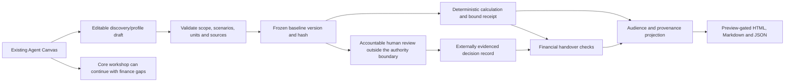

# Agent FinOps baseline-first design

| Field | Value |
|---|---|
| Version | 0.3 |
| Date | 2026-11-12 |
| Author | Copilot SDK in VS Code; AI-assisted design preparation |
| Status | Written spec approved at 2e3c0e7; plan/readiness approved at efb3468, delivery unverified |
| Scope | Versioned offline agent baselines and strict financial build-handover evidence for a 1.10.0 candidate |
| References | [Catalogue](README.md), [Issue #35](https://github.com/urruegg/frontier-envisioning/issues/35), [Decisions #36](https://github.com/urruegg/frontier-envisioning/issues/36), [Idea](../ideas/2026-11-12-agent-finops-baseline.md), [Plan](../plans/2026-11-12-agent-finops-baseline-plan.md), [SPRINT-007](../sprints/SPRINT-007-agent-finops-baseline.md), [ADR-0028](../adr/0028-versioned-agent-finops-baselines.md), [PRD](../prd.md), [Solution design](../solution-design.md) |

## 1. Outcome and authority

Give each agent proposed for build a traceable financial baseline: who owns it,
what demand and outcome it models, which costs it includes, what remains
unknown, how the three scenarios differ and what evidence was reviewed.
Produce reproducible, safely projected Markdown/JSON and Blueprint views.

Draft preparation and core workshops remain possible without FinOps.
Financial completeness is required at **build handover**, not to create an
agent hypothesis. Readiness is planning evidence, not budget approval,
purchase authority, authenticated financial authorisation or deployment
permission.

This specification records the chosen first slice of a larger programme.
It does not replace the authority of the PRD or solution design. After written
review and plan approval, implementation updates those documents additively;
historical requirements, decisions and verification remain intact.

### Input receipt

The maintainer-supplied **Frontier Envisioning Agent FinOps Blueprint** was read
in full: 1,315 lines, 39,037 bytes, SHA-256
`f42abed24fac0f93bbb62420ad3d5e0d7e194eb86d75adccfc94c295c2d797c7`.
It remains read-only outside the repository. No personal source path or whole
document is copied into the plugin. Its product requirements do not prove
every rate, API, licensing statement or sharing claim independently validated.

Baseline source is main `510c907b9bb020a28b352c2910d5f5abcbe8e3a6`,
human-merged #34, version 1.9.2. No source/runtime/version change has been
implemented by preparing this specification.

## 2. Human decisions

The accountable owner is `@urruegg`. On 12 November 2026 the maintainer supplied
the following actual structured answers, recorded on #35 and #36:

| ID | Exact answer | Agreed boundary |
|---|---|---|
| D35-01 | `build-handover` | Baseline required for build handover; drafts/workshops continue with explicit gaps. |
| D35-02 | `baseline-first` | Implement the brief's section 23 offline slice; defer the factory and operating loop. |
| D35-03 | `strict-priced-gate` | Every in-scope cost driver needs an evidenced rate; unpriced blocks financial readiness, with no conditional exception. |
| D35-04 | `versioned-successor` | Successor inside the existing FinOps skill, preserving legacy behaviour and explicit draft migration. |
| D35-05 | `approve-section-2` | Decimal/typed-unit arithmetic, meaningful scenarios, explicit denominators, CHF/EUR/USD and evidenced FX only. |
| D35-06 | `approve-section-3` | Frozen version/hash review, separate validation/pricing/review, honest offline-authority limits and fail-closed sharing. |
| D35-07 | `approve-section-4` | Existing UI, safe exports, synthetic example, actual gates/package proof and an unreleased 1.10.0 candidate. |

The table records the section/scope decisions as they stood before written
review. Subsequently, D35-08 is the actual `approve-written-spec` response for
`2e3c0e79dc45c9ab06775def9f31cfb3bad7a8aa`; the
[implementation plan](../plans/2026-11-12-agent-finops-baseline-plan.md) was
written only after that response. The subsequent actual
`approve-subagent-driven` response (D35-09) approved plan/readiness at
`efb3468dbe597ea6112b6839c7019243ab44b885` and selected subagent-driven work.
Neither unavailable users nor autopilot defaults count as approval.
Protected labels are not inferred.

Document revisions 0.2/0.3 add actual approval receipts and plan/sprint links;
the normative baseline-first contract is the one reviewed at `2e3c0e7`.

## 3. Scope and architecture

### Included

- Agent Canvas linkage, discovery/profile and accountable ownership.
- Versioned baseline contract, rate/source metadata and standard-library
  validation; no new dependency or framework.
- Low/expected/high scenarios, transparent cost lines and unit economics.
- Strict financial handover checks, missing-evidence reporting and review
  records bound to the reviewed content.
- Existing FinOps/Factory/Plan integration, workshop feedback and safe
  Markdown/JSON exports.
- One clearly synthetic Caldova agent, focused regressions, full L1/L2 and
  actual distribution/reproduction verification.

### Excluded

The dedicated Copilot Studio/GitHub harness/Foundry FinOps Agent blueprint
factory, actual-cost ingestion, observed-data reconciliation, recommendation
execution and live provider adapters are later work. No live FOCUS importer,
billing connection, credential store, authenticated approval service, database
or production deployment is implemented. No automatic purchasing, commitments,
spend-limit changes or model changes are permitted.

### Boundaries

Keep eight skills. The successor remains in
[frontier-finops](../../plugin/skills/frontier-finops/), offline and Python
standard-library-only. Use existing agent IDs, Preview/privacy helpers,
wrapper preflight, renderer patterns, package builders and gates.
Do not impose the brief's generic `src/agent-finops` application structure.

Non-numeric, shareable gap/status reporting does not require the FinOps skill
to be installed. Any cost seeding, calculation, application, migration or
figure export requires the existing fresh current-operation Preview awareness
gate. Technical test acknowledgements are not human customer consent.

## 4. Contracts and legacy compatibility

Use the distinct versioned contract `frontier-finops-baseline/1.0`, not a silent
reinterpretation of `frontier-finops/1.0`. Reject unknown schema versions,
duplicate IDs and unresolved agent, baseline, driver, rate or source references
explicitly.
New contract validation follows the repository's JSON/reference and Python
validation conventions; it does not require a third-party schema runtime.

| Record | Required meaning |
|---|---|
| Agent profile | Existing agent ID, canvas linkage, target/pattern, business/technical/finance owners, outcome definition, demand, scope, measurement and guardrails. |
| Baseline revision | Stable baseline ID and version, agent/profile snapshot, dated evaluation context, reporting currency, scenarios, line items, assumptions, exclusions, risks, evidence, confidence and lineage. |
| Cost line | Category/service/meter, recurring or one-time frequency, quantity and unit, rate reference and pricing block/unit, source/evidence basis, allocation policy if shared, and explicit unresolved reasons. |
| Scenario | Low/expected/high, explicit demand and other uncertainty drivers, assumptions and period profile; no invisible final-total multiplier. |
| Rate/FX record | Version, amount and currency, quantity/pricing unit, service/meter, source, effective dates, verification/freshness evidence; FX also declares pair, date and method. |
| Source | ID/type, title/URL or customer evidence reference, validation date/status, sharing classification and the claim/field it supports. Store metadata, not copied reference documents. |
| Review record | Baseline version/hash, explicit human decision, actor, date and evidence reference; financial authority remains externally verified, not authenticated by this plugin. |
| Calculation receipt | Binds material inputs, source/rate/FX versions, scenarios, classification ancestry and calculated results; stale or mismatched results reject before use. |

The baseline supports the brief's cost categories: licence, copilot-credit,
model-token, agent-runtime, tool-call, data, integration, observability,
security-governance, infrastructure, support-operations, build-one-time and
other. Scope exclusions need an explicit reason and review; omitting an
unresolved driver must not make coverage appear complete.

Keep legacy inputs, receipts, privacy and numerical behaviour usable. Do not
silently replace their CHF/FX semantics or promote old estimates into reviewed
baselines. Explicit migration preserves source/classification lineage, leaves
originals unchanged and creates a draft with gaps needing review. A legacy
list-price ratio is not newly validated FX evidence.

The Blueprint uses a separate `agent_finops` projection for active successor
baselines. Do not blend its totals with legacy `finops` or automatically feed
new amounts into old CHF value/NPV calculations. Ambiguous active revisions or
conflicting cost sources require an explicit choice, not a silent winner.

## 5. Calculation and missing-data rules

1. Use decimal arithmetic for the new path, preserving supplied rate precision
   and declaring output rounding. Validate finite, non-negative quantities and
   rates; booleans are not numbers. FX and pricing-block divisors are positive.
   Malformed inputs and unit/currency mismatches have explicit diagnostics.
2. Line cost is the declared quantity times its unit rate, adjusted for its
   pricing block and, only when needed, explicitly evidenced FX. Shared costs
   require a named allocation policy; exact attribution is not inferred.
3. Each scenario varies demand and at least one other explicit uncertainty
   driver, such as tokens per run, retries, retrieval intensity or success
   rate. Preserve these authored drivers and their sources.
4. Report recurring monthly, annual, one-time and first-year estimates.
   Annualisation explicitly identifies flat-demand assumptions or the
   authored monthly profile, including supplied growth/seasonality.
   First-year estimates include declared recurring and one-time costs.
5. Report cost per run, successful run and defined business outcome only when
   the applicable cost and denominator are available. Missing or zero
   denominators give an unavailable value/reason, not zero or infinity.
   Record the period and recurring/first-year cost basis. A known zero is
   valid scenario data with an undefined unit metric; missing required
   demand/outcome inputs remain validation gaps.
6. Initial supported currencies are CHF, EUR and USD, one reporting currency
   per baseline.
   Cross-currency rates need evidenced pair/date/method. Never infer FX from
   list-price ratios; portfolio currencies remain separate without a declared,
   evidenced conversion policy. No automatic portfolio conversion is added.
7. Retain source/effective dates and declared freshness policy. Missing,
   expired, stale or unverified rates/FX remain visible evidence gaps and
   cannot pass financial handover. Do not invent rates or infer licence
   coverage from the harness/audience alone.
8. Forecasts are estimates. Measured/allocated inputs keep their labels and
   provenance; forecast totals do not become measured actuals. No observed
   cost-ingestion capability is claimed.
9. Unknown/unpriced/unquantified is not zero. Drafts may expose a clearly
   labelled priced subtotal. Incomplete full totals and unit metrics remain
   unavailable with reasons rather than complete-looking amounts.
   JSON uses `null` with an explicit status/reason for unavailable values,
   never zero, NaN or infinity. With no priced lines even the priced subtotal
   is unavailable, rather than a misleading empty-sum zero.
10. Coverage is priced declared cost-driver count over in-scope driver count.
    A driver is complete only when all its in-scope lines have applicable,
    evidenced rates/FX and calculable quantities. An empty scope is not
    complete. Do not invent a monetary exposure percentage when the missing
    price makes it unknowable.

Complete pricing means the declared scope is covered, not a guarantee that
every real-world cost has been discovered or a commercial quote. Confidence
and assumptions remain explicit. No arbitrary universal budget, variance or
headroom thresholds are introduced.

## 6. Baseline lifecycle and handover

Separate `draft`, `needs-validation`, `validated`, `approved` and `superseded`
lifecycle information from pricing completeness and current handover checks.
Structural validation alone cannot approve a baseline or pass finance.

Working drafts are editable. A review names a frozen version/content hash
including material profile, scope, quantities, scenarios, rates, FX and source
restrictions. Preserve prior reviewed snapshots. A changed approved baseline
creates a new version, with no inherited review. A new review record must
refer to that new content. Stale source evidence can block a new handover
without rewriting what was reviewed historically.

Financial handover requires all of the following:

- Valid agent/profile linkage, explicit scope, owners, outcome and confidence.
- Valid meaningful scenarios, quantities, units and required calculations.
- Every in-scope cost driver priced with applicable evidenced rates/FX;
  no missing, stale or unverified dependency.
- Recorded assumptions, exclusions, risks, measurement and owner-set guardrails.
- Review evidence matching the frozen version/hash and accountable owner.
- Sharing/provenance validation for the handover audience.

There is **no conditional exception** for unpriced in-scope costs. A raw
`approved` field, imported metadata, browser notes or Preview acknowledgement
cannot satisfy review evidence. Synthetic rates/reviews demonstrate the
workflow but are not actual commercial verification or financial sign-off.

Offline review records are externally evidenced assertions, not authenticated
financial authority, access control or tamper-proof audit storage. Make this
limitation visible. Build handover, spending approval and deployment are
separate decisions. GitHub protected readiness/approval labels are unrelated.

## 7. Privacy, exports and interaction

Preserve legacy restrictions and add explicit `customer-shareable`,
`customer-specific`, `internal-only` and `validation-required` provenance.
Generic original/public-source templates may be customer-shareable.
Customer configuration/data is customer-specific; unknown sharing evidence
stays validation-required. A status or approval flag never declassifies data.

Project for the intended audience before JSON/Markdown/HTML serialisation,
including nested evidence, notes, rates, FX, outcome metrics and aggregates.
Inherited private dependencies withhold their derived values and affected
totals/readiness evidence; do not reconstruct them from public remainders or
substitute zero. A public subtotal is never labelled the complete total.
Customer-specific output is not generic/public distribution clearance.

Add a financial-readiness summary to Agent Canvas and existing Factory/Plan
handover checks: active baseline version, pricing completeness, owner-review
evidence, evaluation date and actionable gaps. Core-only builds report a gap
without importing/calling FinOps. Other handover checks remain independent.
Existing declared build/release/operate stages are not silently rewritten;
their missing finance evidence remains visible in handover checks.

Reuse the FinOps view for profile/discovery, baseline/scenarios, unit economics,
evidence/validation and export. Figures and financial exports retain the
current document-local transient Preview acknowledgement; reload resets it.
Python/Cowork validates and calculates drafts. HTML captures workshop feedback
for a new draft; it does not approve or mutate a frozen baseline or recalculate
authoritative financial results independently.

Markdown/JSON exports retain the warning, currency, formulas, assumptions,
source/rate dates, validation, review limitations and incomplete/withheld
states. The standard tracked Caldova documentation demo remains core-only.
A separate synthetic baseline example exercises calculation and review
mechanics without claiming validated commercial pricing or real approval.

## 8. Public grounding checked on 12 November 2026

| Source | Verified scope and limits |
|---|---|
| [Microsoft: Unit economics](https://learn.microsoft.com/cloud-computing/finops/framework/quantify/unit-economics) | Define the business unit and supporting costs, allocation and measurement. This does not prove a price or implemented attribution/connector. |
| [Microsoft: Azure pricing calculator](https://learn.microsoft.com/azure/cost-management-billing/costs/pricing-calculator) | Anticipated usage/configured rates produce estimates; agreement pricing can differ from public retail, and article example prices are not actual prices. No bundled legacy rate was thereby revalidated. |
| [Microsoft: What is FOCUS?](https://learn.microsoft.com/en-us/cloud-computing/finops/focus/what-is-focus) | Distinguishes billed/effective/list/contracted amounts and quantity/pricing/currency semantics. Reference alignment is not an implemented importer. |
| [FOCUS project](https://focus.finops.org/) | The homepage advertises specification 1.4 while listing Azure generation at 1.2. Specification version and provider support are distinct; no FOCUS conformance is claimed for this slice. |

Only public resource names/concepts were used for public research; the private
input/repository contents were not submitted to search. Source references are
metadata/links, not copied copyrighted reference material or automatic IP
clearance. Changing API/licensing/rate claims need separate dated verification.
The historical PRD's future FOCUS roadmap is not proof of current availability.

## 9. Testable acceptance

| ID | Acceptance |
|---|---|
| AFB-01 | Core/ordinary value builds and sparse/legacy blueprints work without the FinOps skill; no financial operation or figure write occurs before fresh acknowledgement. |
| AFB-02 | Profile and baseline refer to a real existing agent ID; unknown/duplicate IDs, unsupported schemas and invalid units/numbers/dates produce explicit diagnostics. |
| AFB-03 | All three scenarios expose demand plus another differing uncertainty driver; final-total multipliers alone fail validation. |
| AFB-04 | Focused known-answer calculations verify recurring, annual, one-time, first-year and unit economics, including pricing-block conversion and explicit FX. Different currencies are not silently summed. |
| AFB-05 | Missing/stale/unverified rates or FX and unpriced/unquantified lines yield explicit incomplete results, not zero; full totals/unit metrics do not masquerade as complete. |
| AFB-06 | Every unresolved in-scope driver blocks financial handover. Empty scope, forged status fields, local feedback and technical acknowledgement cannot pass it. |
| AFB-07 | A positive, fully evidenced handover case requires matching owner review/version/hash, current source evidence, measurement, guardrails and other required fields. Planning status never grants financial or deployment authority. |
| AFB-08 | Changing reviewed inputs/rates/FX/scenarios/privacy invalidates the old review for the new revision. Historical snapshots remain intact and stale/mismatched receipts reject. |
| AFB-09 | Parent/component/nested private or unknown sharing provenance is withheld before each output format; no private total/rate/note/derived readiness leaks or zero substitutions. |
| AFB-10 | The synthetic Caldova flow is runnable offline and clearly distinguished from real pricing/approval. Explicit legacy migration preserves originals/restrictions, yields a draft and leaves legacy numerical regressions unchanged. |
| AFB-11 | DOM/browser tests verify navigation, gaps, gated figures/exports, reload reset, feedback-not-approval, keyboard/focus access and both colour schemes under the existing CSP/offline rules. |
| AFB-12 | Strict L1/L2 pass, the actual extracted eight-skill package runs the new flow, distribution/privacy checks pass and repeat builds match. Version/provenance/docs changes use existing generators, not hand-edited outputs. |

Add focused red/green tests for new behaviour in existing suites where suitable.
Preserve legacy numerical, cache, source/privacy and acknowledgement regressions.
Run `python tools/dev.py check --strict` and
`python tools/dev.py site e2e --strict`; both must end `ALL GATES PASSED`.
Use the documented bundle/build commands for actual installed-package and
byte-repeatability evidence, not source-only tests or a substituted archive.

## 10. Delivery and pending approval gates

The agreed target is **1.10.0, an unreleased internal candidate**. FinOps remains
Preview; seven other skills remain GA. Follow the normal bump, template,
package and documentation-demo generators. Any new finite raster profile
requires measured input equivalence; do not alter historical profiles/assets
or blanket-enable future versions.

Before implementation: review this written spec, write a bite-sized test-first
plan with real bounded work items, complete the sprint traceability and obtain
explicit human plan/readiness approval. The early SPRINT-007 catalogue row is
draft only; a full sprint file follows the actual plan, not a placeholder.
Do not infer protected label changes from those approvals.

The final draft PR records actual commands/results, package hashes and remaining
manual checks. Live Cowork installation, authenticated tenant/financial checks
and external/IP clearance are separate evidence. A person alone merges,
tags/releases or deploys. Human-owned #8/#30 and protected files are unchanged.
